# Retro: Agent Performance (дашборд + Stats агента + Stats навички) — 2026-10-15
Session: 126dd485 · Workflow: /run-plan (спека і план зроблені вручну раніше) → 9 implementer у 3 хвилях → plan-verifier → architecture ∥ security ∥ /code-review → 3 раунди fix (5+2 implementer, решта в main) → ручна перевірка (hermetic e2e + Chrome) → doc-writer → /pr-self-review ×4 → дві follow-up правки за запитом користувача → integration-тести

## Підсумок
Tokens: 2 645k in-new / 91 326k cache-read / 220k out · Agents: 21 стартував / 18 запусків (+3 форки /code-review), 0 невдалих запусків · Wall 2,1 год / main active 88 хв (сума активності агентів ≈ 73 хв, частково паралельно) · Cost: $17,95 (main $7,33 = 41 %) · Найбільша стаття: implementer W9 ($2,50, 13 хв, 86 tool uses) · Головний урок: **кожен раунд review-fix знаходив дефекти в виправленнях попереднього**, бо фікс мав done-when «finding no longer applies», а не тест; і **integration-тести (Docker був доступний з початку) вперше запущені лише в самому кінці**, де вони показали flaky перф-бюджет.

## Метрики
Таблиці скрипта `collect.mjs` (сесія 126dd485, без змін).

**Підсумок**
- Main: 555k in-new · 46 166k cache-read · 133k out (cache hit 99 %), 185 ходів, active 88 хв / wall 2,1 год.
- Субагенти: 2 090k in-new · 45 160k cache-read · 88k out.
- Разом: 2 645k in-new · 91 326k cache-read · 220k out (thinking всередині output: 44k).
- Запуски: 18 у 8 батчах, стартувало 21, невдалих 0. Вартість $17,95 (тарифи з `prices.json`: sonnet-5-5), main $7,33.

**По агентах (усі)**

| agent | задача | active | tool uses | err | in-new / cache-read / out | cache hit | cost |
|---|---|---|---|---|---|---|---|
| implementer a1276c | W1 contracts | 3 хв | 13 | 0 | 60k / 444k / 0,5k | 88 % | $0,20 |
| implementer a874c7 | W2 DB indexes | 35 с | 11 | 0 | 61k / 286k / 1,1k | 82 % | $0,19 |
| implementer a8ac89 | W3 demo seed | 2 хв | 20 | 0 | 105k / 863k / 10k | 89 % | $0,45 |
| implementer ae1759 | W4 shell | 2 хв | 12 | 0 | 79k / 564k / 0,6k | 88 % | $0,26 |
| implementer a1b018 | W5 server agent-stats | 10 хв | 68 | 0 | 208k / 6 674k / 43k | 97 % | $1,61 |
| implementer a196f0 | W6 client groundwork | 8 хв | 37 | 1 | 147k / 2 859k / 0,9k | 95 % | $0,66 |
| implementer a347ca | W7 dashboard | 6 хв | 37 | 0 | 139k / 3 015k / 1,3k | 96 % | $0,66 |
| implementer a245c2 | W8 agent page | 8 хв | 41 | 1 | 159k / 4 365k / 0,5k | 96 % | $0,84 |
| implementer ab7f77 | W9 skill Stats | 13 хв | 86 | 1 | 349k / 16 011k / 2,6k | 98 % | $2,50 |
| plan-verifier adfc1a | verify (1 матриця) | 5 хв | 38 | 1 | 197k / 4 831k / 18k | 96 % | $1,16 |
| architecture-reviewer a74cb9 | review r1 | 2 хв | 9 | 0 | 39k / 160k / 0,1k | 81 % | $0,11 |
| security-reviewer a7f727 | review r1 | 27 с | 5 | 0 | 42k / 117k / 0,1k | 74 % | $0,12 |
| general-purpose a03300 | /code-review r1 | 3 хв | 10 | 0 | 90k / 499k / 3,7k | 85 % | $0,31 |
| implementer acb1e1 | fix F3 | 2 хв | 4 | 0 | 27k / 66k / 0,3k | 71 % | $0,08 |
| implementer ad8312 | fix F4+F8 | 60 с | 10 | 0 | 31k / 216k / 0,2k | 87 % | $0,10 |
| implementer accd31 | fix F9 | 38 с | 4 | 0 | 25k / 56k / 0,3k | 69 % | $0,07 |
| general-purpose a50874 | /code-review r2 (delta) | 37 с | 4 | 0 | 62k / 147k / 2,5k | 70 % | $0,20 |
| implementer a0f3e9 | fix G1 | 38 с | 4 | 0 | 22k / 77k / 0,1k | 78 % | $0,06 |
| implementer a1e276 | fix G5+G6 | 66 с | 8 | 0 | 46k / 228k / 0,5k | 83 % | $0,14 |
| general-purpose a69e0b | /code-review r3 (delta) | 29 с | 3 | 0 | 58k / 142k / 1,3k | 71 % | $0,17 |
| doc-writer aad79d | docs | 4 хв | 42 | 2 | 145k / 3 541k / 0,4k | 96 % | $0,72 |

Не запускались як агенти: spec-creator, researcher, implementation-planner (зроблені вручну до `/run-plan`), test-writer (поза потоком).

## Порядок запуску

```mermaid
flowchart LR
  B1["Хвиля 1 (∥4): W1 contracts · W2 index · W3 seed · W4 shell"] --> B2["Хвиля 2 (∥2): W5 server · W6 client"]
  B2 --> B3["Хвиля 3 (∥3): W7 · W8 · W9"]
  B3 --> V["plan-verifier (1 матриця)"]
  V --> R["review r1 (∥3): architecture · security · /code-review"]
  R --> F1["fix r1 (∥3): F3 · F4+F8 · F9 (+F2 у main)"]
  F1 --> D2["/code-review r2 (delta)"]
  D2 --> F2["fix r2 (∥2): G1 · G5+G6 (+G2–G4 у main)"]
  F2 --> D3["/code-review r3 (delta)"]
  D3 --> L["ручна перевірка: e2e ×2 + Chrome"]
  L --> DW["doc-writer"]
  DW --> S["/pr-self-review ×4 → follow-up правки → integration-тести"]
```

Критичний шлях: W9 (13 хв) у хвилі 3 (W7 6 хв, W8 8 хв чекали на нього); далі verify 5 хв → review → три раунди fix. Паралельних батчів ≥5 не було, запуски не падали.

- Батч 1: незалежні пакети; усі ≤3 хв (W3 найдовший, 2 хв).
- Батч 3: W9 тримав хвилю: у ньому 3 кроки (контракт → сервер → клієнт) послідовно, 86 tool uses.
- Wall − active у main: 2,1 год − 88 хв ≈ 38 хв — це паузи користувача між відповідями (питання про suggestions, комміт), а не повільний крок.

## Що було складно
- **R1 · W9 skill Stats tab** — 86 tool uses (медіана implementer ≈ 20), 13 хв, 16M cache-read ($2,50, найдорожчий). W9 — один пакет на 8 кроків і ~25 файлів у трьох пакетах (server, client, mcp-server); план обґрунтовував це, але саме він визначив тривалість хвилі 3.
- **R2 · Раунди review-fix знаходили дефекти в попередніх виправленнях** — F2 (main) → G4 «stale-вікно» і G3/G2 від F3; фікс G4 першою спробою зламав 8 тестів дашборда (`period: null`); H1/H3 з'явились у фіксі G4/G3. Усі 3 раунди «delta re-review» знаходили щось нове. Evidence: ledger (`impl.md`): G2–G4 round 2, H1/H3 round 3.
- **R3 · Phase 4: інструмент і середовище** — 4 помилки main-сесії (`javascript_tool` не завантажений, `bash_placeholder` — моя описка, `wait` > 10 с); iframe-метод 320 px 3 рази повертав порожню сторінку; кілька викликів пішло на зависання dev-сервера. Корінь зависання: hermetic-стек і dev-сервер користувача ділять `client/.next` (webpack cache `ENOENT … rename`). Результат: вкладки агента/навички на 320 px, zoom, контраст, цілі 24 px, фокус-tooltip, date-input, skill Refresh лишились неперевіреними.
- **R4 · Реальний баг лейауту знайшов лише Phase 4** — `minmax(300px, 1fr)` у Cost breakdown давав переповнення на 320 px (NFR-15). Implementer не міг виміряти (план забороняв DOM-виміри), reviewers лейаут не дивляться.
- Помилки tool у підагентів: по 1 у W6, W8, W9, verifier, 2 у doc-writer (текст помилок у скрипті не показано — `hypothesis`: невдалі grep/read).

## Що далося легко
- Хвиля 1 та fix-батчі: W2 — 35 с / 11 tool uses; fix F9/G1 — 38 с / 4 tool uses; security-reviewer — 27 с / 5. Спільне: **вузьке питання, названі файли, чітке `done-when`** і фіксований формат відповіді — це шаблон для копіювання.
- plan-verifier після одного повного матричного проходу видав «verified with gaps» без другого раунду (Phase 2 вклався в 1 раунд із 2).
- Жодного resume агента, жодного невдалого запуску, cache hit у великих агентів 95–98 %.

## Дублювання
- **R5 · План читали 13 агентів** (`docs/plans/agent-performance-dashboard.md`, 1 792 рядки ≈ 65k токенів повного читання): усі 9 implementer, обидва рев'юери, verifier, doc-writer і ще. Brief-файл містив лише шляхи, тож він не скоротив читання плану. Чи читали всі файл цілком — `hypothesis` (скрипт показує лише дотик до файлу); запит «Constraints + свій W# + кроки» вимагав вибіркового читання, але вибірка в 1 792 рядках без діапазонів легко стає повним читанням.
- Спільні речення в промптах: лише шлях брифу ×18 (~864 символів) — **нічого вартого виправлення**; промпти короткі (0,3–1,4k символів). `shared prompt sentences` до 75 % у reviewers — через однакову структуру, не через повторення правил.
- Файли, які читають ≥ 6 агентів (`stats-service.ts` — 9, `agent-stats.ts` hooks — 9, `repository.ts` — 8): здебільшого `/code-review` + `doc-writer` + `plan-verifier` + implementer-и W9 — читання потрібне для їхньої роботи; окремої передачі за шляхом не потребує.
- Один і той самий review-ledger переказувався три рази (в state-файлі, у відповідях користувачу та у звіті self-review) — `hypothesis`, дрібна втрата.
- Resume: 0, тому «context re-read» немає.

## Що пропустили

**Gap-closure таблиця** (з «Gaps the agents reported themselves»):

| Агент | Прогалина | Закрито ким | Статус |
|---|---|---|---|
| architecture-reviewer | не читав `agent-stats/helpers.ts`/`repository.ts` рядок за рядком | `/code-review` r1 (F4, F5, F8 …) | closed |
| architecture-reviewer | не писав у INSIGHTS (read-only) | нікому — за дизайном | open-deferred |
| security-reviewer | клієнтські файли лише grep на sink'и | main-сесія `/pr-self-review`: знайшов WARNING (`useRunTrace` без `encodeURIComponent`) → виправлено | closed (пізно, поза reviewers) |
| security-reviewer | SQL міграції не рев'ювалась | не потребує (згенерована, 2 індекси) | open-deferred |
| doc-writer | `e2e/specs/coverage.md` і flow AC-186/187 не існують | **нікому: `test-writer` поза `/run-plan`, нічого не запланувало його запуск** | **open-deferred, без власника → R6** |
| doc-writer | немає `mermaid-diagram/references.md` | нікому | open-deferred (дрібний дефект skill) |
| main-сесія | live-перевірки (320 px вкладки, zoom, контраст, цілі, фокус-tooltip, date-input, skill Refresh, 100 мс скелет) | нікому в цій сесії | open-deferred (залишено користувачу) |

- **R6 · AC-186/187 і `e2e/specs/coverage.md` без власника** — план віддав їх `test-writer`, `/run-plan` його не викликає (принцип 7), PR-фаза про них лише згадує. Вимога спеки (AC-186/187) лишається без реалізації та без наступного кроку.
- **Те, що пізніша фаза знайшла, а раніша мала б:** W7 пропустив `helpers.test.ts` зі свого кроку S16 (verifier знайшов); два approve-вердикти з 0 findings (architecture, security) при тому, що `/code-review` знайшов 9 findings (два реальні баги) і `/pr-self-review` ще один security-WARNING; integration-тести (T8/T9) вперше запущені після всього — там і з'ясувалось, що 366-денний перф-тест дає 542 мс під паралельним навантаженням.
- **Самокоригування:** я пропустив крок Phase 1.4 «Integration gate» — тести `*.it.test.ts` лишились на Phase 6, хоча `docker info` був «up» ще на початку; саме користувач попросив їх запустити.
- Вимоги користувача без власника: усі ключові вимоги мали власника; follow-up (клік по чарту, View trace → дроуер) зроблений у main без агентів, спека отримала нотатку про відхилення (AC-160/161).
- Макети: усі 4 зображення були в плані й імплементери отримали їхні шляхи; W7 зафіксував, що іконки-квадрати агентів з макета не відтворені (немає даних) — це свідомий non-goal, не прогалина.

## Порівняння з попередніми запусками
Останні `/run-plan` у ledger: PR Brief (2026-10-03) 3 124k in-new / 64,6M cache-read / 204k out, 17 стартувало, main 96 хв · Multi-Agent Review (2026-10-09) 2 824k / 70,9M / 216k, 24 стартувало, $21,61 · Onboarding Tour (2026-10-02) 2 946k / 62,3M / 136k, 29 стартувало.
Цей запуск: **2 645k in-new (найменше з чотирьох), 91,3M cache-read (найбільше), $17,95 (дешевше за Multi-Agent $21,61), 21 стартував.** Дешевший за in-new, бо спека й план зроблені вручну до `/run-plan` і в ці цифри не входять (у Multi-Agent рядку spec ×8 були всередині). Дорожчий за cache-read через довшу main-сесію (46M, 185 ходів — вона охоплює і follow-up-и, self-review ×4 та integration-тести) і W9 (16M). Одна зміна, що пояснює більшість різниці: порівнювані запуски включали spec/planner агентів, цей — ні. Порівняння не «яблуко до яблука» (`hypothesis`).

## Рекомендації

| R# | Зміна | Де | Очікуваний ефект | Вартість | Впевненість |
|---|---|---|---|---|---|
| R1 | У Phase 3 «Fix» вимагати від кожного fix-кроку тест, що падає без виправлення (або явне «тест неможливий — чому»); `done-when` = «тест зелений», а не «finding no longer applies» | `.claude/skills/run-plan/SKILL.md` (Phase 3), `.claude/agents/implementer.md` | менше раундів: у цьому запуску 3 раунди знаходили дефекти в фіксах | малий (1 абзац) | висока |
| R2 | Phase 1.4: на інтейку одноразово перевірити `docker info`, записати в state; якщо Docker є — main запускає `*.it.test.ts` плану одразу після хвилі, що їх додала (не лишати на Phase 6) | `run-plan/SKILL.md` (Phase 0/1), `server/AGENTS.md` | перф-flake і ризик F8 з'ясовуються до рев'ю, а не після | середній (+1–2 хв на хвилю) | висока |
| R3 | `./scripts/e2e.sh --keep-up` (стек лишається, друкує URL) і окремий `distDir`/`NEXT_DIST_DIR` для hermetic web, щоб не псувати `client/.next` dev-сервера; у Phase 4 — «верхньорівнева навігація + javascript_tool; iframe-метод лише з перевіркою, що фрейм відрендерився» | `scripts/e2e.sh`, `client/next.config.*` або `scripts/e2e.sh` env, `run-plan/SKILL.md` Phase 4, `client/INSIGHTS.md` | менше зависань і ручних обхідних кроків у Phase 4; кеш dev-сервера не псується | середній | середня |
| R4 | Одне речення в `client/INSIGHTS.md` і в лейн frontend-components: `grid minmax(Npx, 1fr)` → `minmax(min(Npx, 100%), 1fr)` (переповнення на 320 px) | `client/INSIGHTS.md`, `.claude/skills/react-best-practices` або lane-таблиця implementer | запобігає тому самому багу, який знайшла лише Phase 4 | мінімальний | висока |
| R5 | Замість «прочитай план» — для кожного W# main (або planner) пише `docs/plans/<slug>.wp/<W#>.md`: лише потрібні C#, кроки, appendix-діапазони; implementer отримує його шлях | `run-plan/SKILL.md` (Principle 8), `implementation-planner.md` (вихідний формат: діапазони рядків) | плану 1 792 рядки читали 13 агентів; менше in-new на кожному старті | середній (генерація карток) | низька-середня (немає виміру обсягу читання) |
| R6 | Дати AC-186/187 і `e2e/specs/coverage.md` власника: у Phase 6 крок «e2e-flow'и за планом → запустити `test-writer` (запитати користувача)»; у state-файл — рядок «owed: test-writer» | `run-plan/SKILL.md` (Phase 6, State file) | вимога спеки не залишається без реалізації мовчки | малий | висока |
| R7 | Зробити відбиток `gate.sh` залежним від вмісту дерева відносно merge-base, а не від SHA `HEAD`, щоб комміт без зміни змісту не робив звіт застарілим | `.claude/skills/pr-self-review/assets/gate.sh` (+ `report.md`) | у цьому запуску після кожного з 3 коммітів gate казав BLOCKED, звіт перегенерувався 3 рази (повні CI-прогони) | середній; ризик: послаблює «звіт ↔ коміт» | середня (потребує рішення про семантику) |
| R8 | У тріажі Phase 3 виводити «Not found / gaps» кожного рев'юера як окремі рядки ledger (open-coverage), щоб «approve, 0 findings» не читалось як «усе покрито» | `run-plan/SKILL.md` (Phase 3 Ledger), формат відповіді `architecture-reviewer.md`/`security-reviewer.md` | видно, що клієнтський код не рев'ювався security (пізніше знайдено WARNING) | малий | середня |

**Рішення користувача (2026-10-15):** застосовано R1, R2, R4, R6, R8 — R1/R2/R6/R8 в `.claude/skills/run-plan/SKILL.md` (кроки Fix, Integration gate, Phase 6, шаблон state-файлу і ledger з рядками `GAP`), R4 у `client/INSIGHTS.md`; агентські файли не змінювались (тому evals моделі не потрібні). Перевірено: `pnpm eval:quality` — 23 skills, 0 failures; evals для `run-plan` немає (`SKIP (no evals)`). Збережено лише як нотатки: R3 (`e2e.sh --keep-up` + окремий distDir), R5 (картки W#), R7 (відбиток `gate.sh` без SHA `HEAD`).

## Не перевірено
- Метрики охоплюють **весь чат** (включно з follow-up правками користувача, 4 self-review і integration-тестами), а не лише `/run-plan`; розбивки за фазами скрипт не дає. Spec-creator/planner (виконані вручну в інших сесіях) у цифри не входять.
- *Active time* відкидає проміжки > 5 хв; «файли, прочитані кількома агентами» — евристика за рядком шляху; не видно, чи агент читав файл цілком (`R5` — `hypothesis`).
- Текст помилок tool у підагентів (W6, W8, W9, verifier, doc-writer) не відкривався (`--handback` не використовувався).
- Вартість — оцінка за `prices.json` (sonnet-5-5 для всіх; main-сесія працювала на Sonnet 5.5 з команди `/model`); тривалість «хвилини людини» не заміряна.
- Порівняння з минулими запусками не рівноцінне (спека/план всередині або поза запуском).
