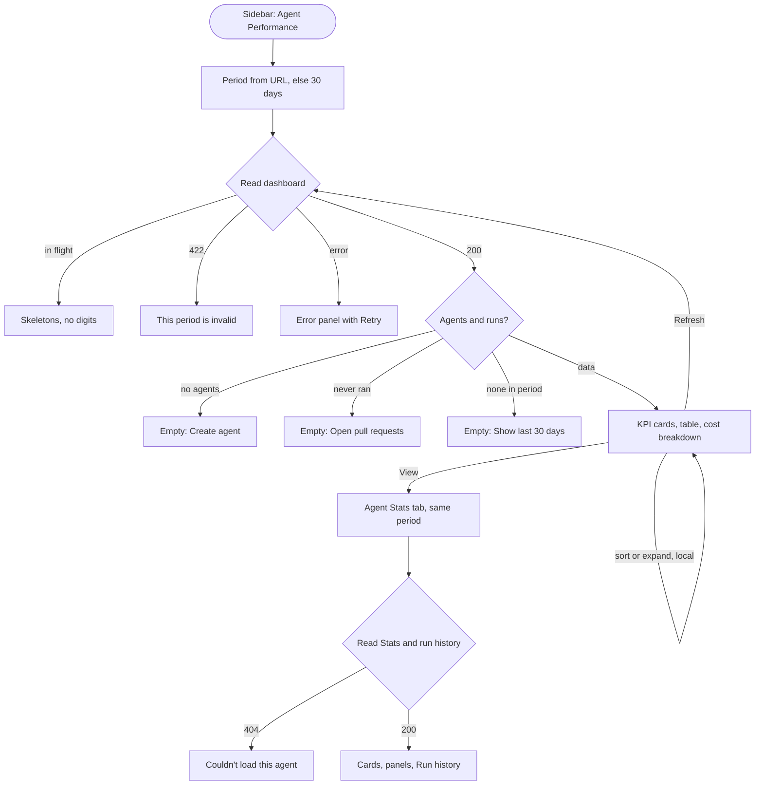
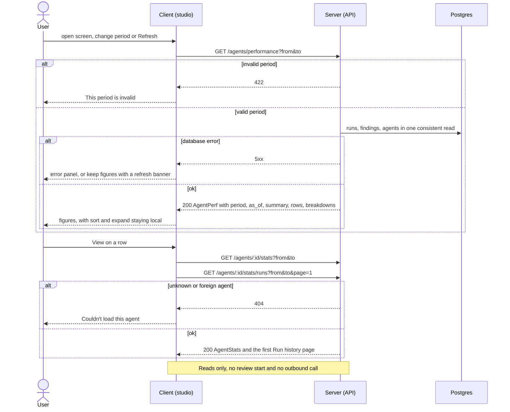

# Spec: Agent Performance — global dashboard, agent Stats tab and agent-card stats
Spec ID: 2026-10-15-agent-performance-dashboard
Status: implemented
Supersedes: none
Modules: server, client, e2e

## Problem and user

The user is an agent owner. They have several review agents (the seed ships General, Security and Performance Reviewer plus skill agents) and run them on pull requests, locally and in multi-agent groups. They want to know which agents are worth what they cost: how often each one runs, what it costs, how long it takes, and how many of its findings people accept.

Today they cannot see this:
- **No aggregate view exists.** Every run is stored with its agent, model, duration, cost and status (`server/src/db/schema/runs.ts:8-44`). Each finding is linked to its run and carries an accept or dismiss decision (`server/src/db/schema/reviews.ts:17-19,44-45`; run id set at `server/src/modules/reviews/run-executor.ts:399-411`). No screen adds these up per agent or for the workspace.
- **The agent Stats tab does not exist.** The request assumes it does, but the agent editor has Config, Skills, Context, Evals and CI only. Its own comment says "Stats belongs to a later lesson" (`client/src/app/agents/[id]/_components/AgentEditor/constants.ts:10-18`, `client/src/app/agents/[id]/constants.ts:2`).
- **Two contracts were reserved but never used.** `AgentStats` (`server/src/vendor/shared/contracts/observability.ts:119-150`) and `AgentPerf` (`server/src/vendor/shared/contracts/productionize.ts:136-187`) were declared ahead of time. No route, hook or screen uses them.
- **The only per-agent figures in the studio are run estimates.** They are averages over each agent's last 5 done runs, shown in the multi-agent picker (`server/src/modules/reviews/repository/multi-agent.repo.ts:168-201`). They have no period and no accept rate.
- **Accept rate exists only for skills.** The skill Stats tab computes it, with a different rule: by review creation date over a fixed 30 days (`server/src/modules/skills/helpers.ts:293-313`, `server/src/modules/skills/repository.ts:341-360`).
- **A stored cost does not say where it came from.** It can be three different things, with nothing to tell them apart:
  - for OpenRouter runs, the cost OpenRouter reported for the call;
  - otherwise, an estimate from DevDigest's price table (`reviewer-core/src/llm/openrouter.ts:135-146`, `server/src/platform/price-book.ts:33-39`, `server/src/adapters/llm/pricing.ts:37-41`);
  - for every OpenAI and Anthropic run, always the price table (`server/src/adapters/llm/openai.ts:76`, `server/src/adapters/llm/anthropic.ts:85`).
- **Nothing is checked against billing, and nothing says so.** No code compares stored costs with any provider's billing (RQ1c), and no screen tells the owner that the figures are DevDigest's own records.

What this costs the owner today:
- To compare agents they open PR after PR and add up runs, costs and decisions by eye.
- They cannot judge an accept rate without knowing its denominator.
- They cannot tell whether a dollar figure is a billed amount or DevDigest's own record.

## Goals / Non-goals

Goals
- A global **Agent Performance** screen in the sidebar's GLOBAL section. It has:
  - KPI cards: Total runs, Total cost, Avg accept rate and Most-active agent;
  - a per-agent table: Agent, Runs, Avg cost, Avg duration, Accept, Last run and View, with sorting and an expandable row;
  - cost breakdowns by agent and by model.
- A **Stats** tab on each agent. It shows the same figures for that agent, plus Most-used skills, Findings by severity, Findings by category and Run history.
- One period choice on both screens: 1 day, 30 days or a custom range. It is kept in the URL, so a dashboard row and the agent's Stats tab show the same period.
- One set of aggregation rules for both screens. A dashboard row equals the agent's Stats for the same stored data and period.
- The accept rate is always shown with its denominator. Small samples are marked, and they are ranked after the agents with enough decisions.
- Every cost figure is clearly marked as cost recorded by DevDigest, not reconciled with provider billing. One explanation says how DevDigest records cost, and the screens show how many runs have an unknown cost (Q23).
- Loading, empty and error states are distinct and never show made-up zeros. Nothing on these screens makes an outbound call: no review, no model call, no GitHub or other external request.
- Changes against the previous period of the same length: total cost, average cost per run and accept rate.
- A 30-day stats line on each agent card in the Agents list.
- Seeded demo runs, plus an e2e check that a dashboard row equals the agent's Stats tab.

Non-goals
- **A Most-pulled memory panel.** There is no data source: every stored trace records `memory_pulled: []` (`server/src/modules/reviews/run-executor.ts:455,759`) (Q2).
- **CI runs and eval runs in any figure** (Q5). CI runs stay on the CI Runs page and eval suite runs on the Eval Dashboard, and the Run history has no Source column.
- **Reconciled billing data from any provider, per request or per day.** This is a possible follow-up feature (Q23). The evidence:
  - OpenRouter's stored `usage.cost` is already "the total amount charged". Its per-generation lookup (`GET /api/v1/generation`) would re-check that same figure from the same source (RQ1a).
  - OpenRouter's `/credits` and `/activity` need a management key and return only aggregates (RQ1a).
  - OpenAI and Anthropic offer only daily cost reports behind admin keys, with no per-request cost (RQ1b).
  - Stored runs keep no generation id, so existing runs could never be reconciled per request (RQ1c).
- **Recording a per-run cost basis** (provider-reported or price-table estimate). This is a possible follow-up. The basis is not stored today (RQ1c), so the screens explain both possibilities in one info text instead of labelling each run (Q23).
- **Recording the cost of failed and cancelled runs.** Their cost stays unknown, as today (`run-executor.ts:161-169,489-497`) [proposed → Q-6].
- **Live updates or polling.** The figures change only on reload, Refresh or a period change.
- **A repository filter or a per-repository breakdown.** The scope is the whole workspace (Q13).
- **Any change to `GET /runs/estimates`** (last 5 done runs). It keeps its own rule.
- **Any change to the skill Stats tab, or aligning its accept-rate rule with this one.**
- **Any change to the PR list's cost or findings columns, the PR run timeline, the run trace drawer or the multi-agent columns.** In particular, none of them gets the cost label.
- **Exporting the data**, for example to CSV.
- **Editing or superseding the implemented spec `2026-10-09-multi-agent-review`** (Q10).

## User stories

- US-1 [must]: As an agent owner, I want a global Agent Performance screen with totals and a per-agent table for a chosen period, so that I can compare agents' runs, cost, speed and accept rate in one place.
- US-2 [must]: As an agent owner, I want to choose 1 day, 30 days or a custom date range on both screens, so that I can look at the period I care about and compare the same period across screens.
- US-3 [must]: As an agent owner, I want each agent's Stats tab to show the same numbers as its dashboard row plus run-level detail, so that I can investigate one agent.
- US-4 [must]: As an agent owner, I want every accept rate shown with its denominator and small samples marked, so that I don't trust a rate built on a handful of decisions.
- US-5 [must]: As an agent owner, I want cost broken down by agent and by model, adding up exactly to the total, with a clear label that these are DevDigest-recorded costs and not reconciled provider billing, so that I know how far to trust each dollar figure.
- ~~US-6~~ — dropped per Q23 (the Sync billing action is removed).
- US-7 [must]: As an agent owner, I want loading, empty and error states that never show invented zeros, and I want these screens never to start a review, a model call or any other outbound call, so that the numbers are honest and looking costs nothing.
- US-8 [should]: As an agent owner, I want each agent card in the Agents list to show its 30-day runs, accept rate and average cost, so that I see the summary without opening the Stats tab.
- US-9 [must]: As the course author, I want seeded demo runs and an e2e flow that checks a dashboard row against the agent's Stats tab, so that the demo and the "numbers match" criterion can be checked without an LLM key.
- US-10 [should]: As an agent owner, I want to see how cost and accept rate changed against the previous period of the same length, so that I can spot trends.

## Acceptance criteria (EARS)

### Terms

The criteria below use these terms:

- **Period:** the interval from `from` (included) to `to` (excluded), given as exact timestamps.
- **Counted run:** a review run stored for the caller's workspace, with status `done`, `failed` or `cancelled` and a start time inside the period. CI runs and eval runs are not review runs (Q5).
- **Decided finding:** a finding produced by a counted run with status `done` that is accepted or dismissed when the stats are read.
- **Pending finding:** a finding produced by such a run that is neither accepted nor dismissed.
- **Known cost:** a counted run whose stored cost is not null. A stored cost of exactly 0 is a known cost of $0.00.
- **Unknown-cost count:** the number of counted runs whose stored cost is null.
- **Small sample:** fewer than 10 decided findings (Q7).
- **Previous period:** the interval of the same length that ends at `from` (Q16).
- **Cost label** (Q23) [placement proposed → Q-9]:
  - A short visible marker meaning "recorded by DevDigest — not reconciled with provider billing". It has an info control that shows the cost info text (AC-189). The final copy comes from the message catalog.
  - It appears once per cost section or column, not on every value. The places are: the dashboard Total cost card, the agents table's Avg cost header, the Cost breakdown heading, the Stats Avg cost card, the Run history Cost header and the average cost on each agent card.
- **Accept scale** (Q17), applied to the displayed whole-percent value:
  - 75 and above: good;
  - 50–74: warning;
  - below 50: poor;
  - grey for a small sample.
- **Bucket rule** for the runs sparkline (EC-31, Q19): buckets start at `from` and are hourly for a period of up to 2 days, daily up to 90 days and weekly beyond.
- **Amount format:**
  - totals and breakdown amounts: dollars and cents (Q11);
  - averages and per-run costs: two significant digits below $1, for example "$0.0013" [proposed → Q-8].

### Shared aggregation rules (server)

- AC-1 [ubiquitous, US-1, must, verify: integration] The server shall count a run in a period when it is a review run of the caller's workspace with status `done`, `failed` or `cancelled` and a start time at or after the period's `from` and before its `to` (EC-24, EC-29, EC-30).
- AC-2 [unwanted, US-7, must, verify: integration] ЯКЩО a run has status `running` when the stats are read, ТОДІ the server shall leave it out of every figure except the in-progress count (EC-6).
- AC-3 [ubiquitous, US-7, must, verify: integration] The server shall report as the in-progress count the number of the workspace's runs with status `running` whose start time is in the period.
- AC-4 [ubiquitous, US-1, must, verify: integration] The server shall report Runs as the number of counted runs (Q4).
- AC-5 [ubiquitous, US-1, must, verify: integration] The server shall report the number of counted runs with status `failed` and the number with status `cancelled` as two separate counts (Q4).
- AC-6 [ubiquitous, US-5, must, verify: integration] The server shall report Total cost as the exact, unrounded sum of the stored costs of counted runs with a known cost (Q4, Q11).
- AC-7 [unwanted, US-7, must, verify: integration] ЯКЩО no counted run has a known cost, ТОДІ the server shall report Total cost and Avg cost as null, never as 0 (EC-3).
- AC-8 [ubiquitous, US-1, must, verify: integration] The server shall report Avg cost as Total cost divided by the number of counted runs with a known cost (Q4).
- AC-9 [ubiquitous, US-1, must, verify: integration] The server shall report Avg duration as the mean stored duration of counted runs with status `done` (Q4).
- AC-10 [unwanted, US-7, must, verify: integration] ЯКЩО no counted run has status `done`, ТОДІ the server shall report Avg duration as null.
- AC-11 [ubiquitous, US-4, must, verify: integration] The server shall report the accepted, dismissed and pending counts over the findings produced by counted runs with status `done`, counting each finding by its decision at read time (Q6; EC-22, EC-23, EC-27).
- AC-12 [ubiquitous, US-4, must, verify: integration] The server shall report Accept rate as accepted ÷ (accepted + dismissed), a number from 0 to 1 (Q6).
- AC-13 [unwanted, US-4, must, verify: integration] ЯКЩО accepted + dismissed is 0, ТОДІ the server shall report Accept rate as null (EC-48).
- AC-14 [ubiquitous, US-4, must, verify: integration] The server shall flag each figure set (the summary, each row and the previous-period figures) as a small sample when its accepted + dismissed count is below 10 (Q7).
- AC-15 [ubiquitous, US-1, must, verify: integration] The server shall group the counted runs of deleted agents into one row with a null agent id, the "Deleted agent" row (EC-1).
- AC-16 [ubiquitous, US-5, must, verify: integration] The server shall report the unknown-cost count with the summary and with each row (Q23; EC-3). *(edited per Q23: was a cost split by cost basis)*
- AC-17 [event, US-3, must, verify: integration] КОЛИ an agent's Stats are read for the same fixed period as a dashboard read, with no stored change in between, the server shall return the following figures equal to that agent's dashboard row: Runs, the failed and cancelled counts, Total cost, Avg cost, the unknown-cost count, Avg duration, the accepted, dismissed and pending counts, and Accept rate (EC-7). *(edited per Q23)*

### Dashboard response (server)

- AC-18 [ubiquitous, US-1, must, verify: integration] The server shall report the summary's Runs, failed and cancelled counts, Total cost, unknown-cost count and accepted, dismissed and pending counts as the sums of the same figures over all rows, including the Deleted agent row (EC-28). *(edited per Q23)*
- AC-19 [ubiquitous, US-4, must, verify: integration] The server shall report Avg accept rate as the summary's accepted ÷ (accepted + dismissed), pooled over all rows (Q8).
- AC-20 [ubiquitous, US-1, must, verify: integration] The server shall report as Most-active the existing agent with the most counted runs, breaking a tie by the latest run start time and then by agent name A→Z (EC-1, EC-10).
- AC-21 [unwanted, US-1, must, verify: integration] ЯКЩО no existing agent has a counted run, ТОДІ the server shall report Most-active as null (EC-11).
- AC-22 [ubiquitous, US-1, must, verify: integration] The server shall return one row per agent of the workspace, enabled or disabled, including agents with 0 counted runs, each row keyed by agent identity rather than name (Q12; EC-16).
- AC-23 [ubiquitous, US-1, must, verify: integration] The server shall report each row's Last run as the start time of the agent's latest run with status `done`, `failed` or `cancelled` at any time, or null when the agent never ran (EC-32).
- AC-24 [ubiquitous, US-1, must, verify: integration] The server shall report with each row up to 5 of the agent's latest counted runs with status `done`, oldest first, each with its start time, duration and cost (Q15). *(edited per Q23: no cost basis)*
- AC-25 [ubiquitous, US-5, must, verify: integration] The server shall report the cost by agent as one entry per row with a known cost above 0, the amounts summing exactly to Total cost (Q11; EC-1).
- AC-26 [ubiquitous, US-5, must, verify: integration] The server shall report the cost by model as one entry per stored model of the counted runs with a known cost above 0, putting runs without a stored model into one null-model entry, the amounts summing exactly to Total cost (EC-2, EC-17).
- AC-27 [ubiquitous, US-1, must, verify: integration] The server shall report the number of counted runs per bucket of the bucket rule, for the Total runs sparkline (EC-31).
- AC-28 [ubiquitous, US-7, must, verify: integration] The server shall report the workspace's agent count and the start time of its latest finished run at any time, including deleted agents' runs (EC-5).
- ~~AC-29~~ — dropped per Q23 (count of runs awaiting billing reconciliation; reconciliation removed).

### Agent Stats response (server)

- AC-30 [ubiquitous, US-3, must, verify: integration] The server shall report the findings of the agent's counted runs with status `done`, of every kind and every decision, per severity (`CRITICAL`, `WARNING`, `SUGGESTION`) and per bucket. The buckets start at `from` and are 4 hours long for a period of up to 2 days, 1 day up to 14 days, 7 days up to 120 days and 30 days beyond [proposed → Q-7].
- AC-31 [ubiquitous, US-3, must, verify: integration] The server shall report the same findings counted per category (Q2).
- AC-32 [ubiquitous, US-3, must, verify: integration] The server shall report, for each skill recorded in the agent's counted runs, the number of counted runs whose recorded skill list contains it, with the number of counted runs that recorded a skill list and the number that did not (Q2; EC-44).
- AC-33 [ubiquitous, US-3, must, verify: integration] The server shall return the agent's counted runs newest first, 20 per page. Each run comes with its start time, status, repository, PR number, tokens in and out, cost and findings count (Q2, Q18). *(edited per Q23: no cost basis)*
- AC-34 [ubiquitous, US-10, should, verify: integration] The server shall report, for the previous period, the summary's Total cost, each row's Accept rate and small-sample flag, and the agent's Avg cost (Q16).

### Request validation (server)

- AC-35 [unwanted, US-2, must, verify: integration] ЯКЩО `from` or `to` is missing or is not an ISO-8601 timestamp with a time-zone offset, ТОДІ the server shall respond 422 with no figures.
- AC-36 [unwanted, US-2, must, verify: integration] ЯКЩО `from` is not before `to`, `from` is later than the server's current time, or `to` − `from` exceeds 367 days (366 calendar days plus daylight-saving slack), ТОДІ the server shall respond 422 with no figures (EC-9).
- AC-37 [unwanted, US-3, must, verify: integration] ЯКЩО the run-history `page` is not an integer of at least 1, ТОДІ the server shall respond 422.
- AC-38 [unwanted, US-3, must, verify: integration] ЯКЩО the agent of a Stats or run-history request is unknown or belongs to another workspace, ТОДІ the server shall respond 404 (EC-21).
- AC-39 [ubiquitous, US-2, must, verify: integration] The server shall return with every stats response the period it used, the previous period and the read time `as_of`.

### Read-only guarantee

- AC-40 [ubiquitous, US-7, must, verify: integration] The server shall start no review run and make no outbound call (no LLM provider, GitHub or other external request) while serving a stats or run-history request (Q23; EC-18). *(edited per Q23)*
- AC-41 [ubiquitous, US-7, must, verify: unit] The client shall send only GET requests when the user does any of the following on either screen: open, reload or refresh it, change the period, sort, expand a row, page the run history, or follow View (EC-18).
- AC-42 [event, US-7, must, verify: unit] КОЛИ a read for a period is requested while a read for the same period is in flight, the client shall send no second request (EC-18).
- AC-43 [ubiquitous, US-7, must, verify: unit] The client shall not re-read the stats on a timer (EC-8).

### Period control (client)

- AC-44 [ubiquitous, US-2, must, verify: unit] The Agent Performance screen and the agent Stats tab shall each show a period control with the options "1 day", "30 days" and "Custom range", with "30 days" selected by default (Q9; UX-7).
- AC-45 [event, US-2, must, verify: unit] КОЛИ the user picks "1 day", the client shall request the period from 24 hours before now to now (Q9).
- AC-46 [event, US-2, must, verify: unit] КОЛИ the user picks "30 days", the client shall request the period from 30 × 24 hours before now to now (Q9).
- AC-47 [event, US-2, must, verify: unit] КОЛИ the user applies a custom range, the client shall request the period from 00:00:00.000 of the start date to 00:00:00.000 of the day after the end date, in the browser's time zone (Q9).
- AC-48 [unwanted, US-2, must, verify: unit] ЯКЩО a custom range has a start date after its end date, an end date after today, more than 366 calendar days or an incomplete date, ТОДІ the period control shall keep Apply disabled (EC-9).
- AC-49 [unwanted, US-2, must, verify: unit] ЯКЩО Apply is disabled for an invalid custom range, ТОДІ the period control shall show the reason as text tied to the date field (EC-9).
- AC-50 [event, US-2, must, verify: unit] КОЛИ a period is resolved, the client shall write the option and the exact `from` and `to` into the page URL (EC-25).
- AC-51 [event, US-2, must, verify: unit] КОЛИ a page opens with a valid option, `from` and `to` in its URL, the client shall request exactly that period without re-resolving it (EC-25).
- AC-52 [unwanted, US-2, must, verify: unit] ЯКЩО the URL's period values are missing or invalid, ТОДІ the client shall use "30 days", resolved at load.
- AC-53 [unwanted, US-2, should, verify: unit] ЯКЩО the URL holds period values that are invalid, ТОДІ the client shall show the notice "The link's period was invalid — showing the last 30 days".
- AC-54 [ubiquitous, US-2, must, verify: unit] The client shall name the selected option in every period-dependent label, for example "Total runs (30 days)", "(1 day)" or "(custom range)".
- AC-55 [ubiquitous, US-2, must, verify: unit] The client shall show the resolved start and end of the period as local date-and-time text next to the period control.
- AC-56 [event, US-7, must, verify: unit] КОЛИ the user clicks the topbar Refresh on either screen, the client shall read the stats again, re-resolving a "1 day" or "30 days" option to the current time (UX-2; EC-7, EC-8, EC-25).
- AC-57 [ubiquitous, US-7, must, verify: unit] The client shall show "Updated HH:MM", taken from the response's `as_of`, on both screens (UX-2; EC-7).

### Cost basis recording — dropped per Q23

Per-run generation-id capture and cost-basis recording are removed (Q23).

- ~~AC-58~~ — dropped per Q23 (reviewer-core reporting generation ids).
- ~~AC-59~~ — dropped per Q23 (reviewer-core reporting a per-request cost basis).
- ~~AC-60~~ — dropped per Q23 (storing generation ids).
- ~~AC-61~~ — dropped per Q23 (storing a cost basis).
- ~~AC-62~~ — dropped per Q23 (storing a reconciliation state).
- ~~AC-63~~ — dropped per Q23 (invalid generation id → state `none`).
- ~~AC-64~~ — dropped per Q23 (cost basis of pre-feature runs).
- ~~AC-65~~ — dropped per Q23 (OpenAI/Anthropic runs excluded from lookup).

### Sync billing (server) — dropped per Q23

The Sync billing action and every OpenRouter `/generation` call are removed (Q23).

- ~~AC-66~~ — dropped per Q23 (generation lookup on sync).
- ~~AC-67~~ — dropped per Q23 (200-lookup cap).
- ~~AC-68~~ — dropped per Q23 (60 s time limit).
- ~~AC-69~~ — dropped per Q23 (storing a confirmed generation).
- ~~AC-70~~ — dropped per Q23 (reconciled cost = sum of billed amounts).
- ~~AC-71~~ — dropped per Q23 (marking a run reconciled).
- ~~AC-72~~ — dropped per Q23 (no repeat lookup of a confirmed generation).
- ~~AC-73~~ — dropped per Q23 (reconciled run unchanged by later syncs).
- ~~AC-74~~ — dropped per Q23 (sync result body).
- ~~AC-75~~ — dropped per Q23 (`openrouter_key_missing`).
- ~~AC-76~~ — dropped per Q23 (`openrouter_key_invalid`).
- ~~AC-77~~ — dropped per Q23 (early stop keeps confirmations).
- ~~AC-78~~ — dropped per Q23 (404 within 24 h → pending).
- ~~AC-79~~ — dropped per Q23 (404 after 24 h → `not_found`).
- ~~AC-80~~ — dropped per Q23 (429 retry).
- ~~AC-81~~ — dropped per Q23 (repeated 429 → `rate_limited`).
- ~~AC-82~~ — dropped per Q23 (5xx, network error, timeout).
- ~~AC-83~~ — dropped per Q23 (`invalid_response`).
- ~~AC-84~~ — dropped per Q23 (`mismatch`).
- ~~AC-85~~ — dropped per Q23 (`byok_not_supported`).
- ~~AC-86~~ — dropped per Q23 (`invalid_id`).
- ~~AC-87~~ — dropped per Q23 (failed reconciliation keeps cost).
- ~~AC-88~~ — dropped per Q23 (409 `billing_sync_in_progress`).
- ~~AC-89~~ — dropped per Q23 (no model call during a sync; AC-40 and NFR-5 now cover every action).

### Sync billing (client) — dropped per Q23

- ~~AC-90~~ — dropped per Q23 ("Sync billing" button).
- ~~AC-91~~ — dropped per Q23 ("n runs awaiting billing sync").
- ~~AC-92~~ — dropped per Q23 (sync request on click).
- ~~AC-93~~ — dropped per Q23 ("Syncing billing…" state).
- ~~AC-94~~ — dropped per Q23 (sync result message).
- ~~AC-95~~ — dropped per Q23 (re-read after sync).
- ~~AC-96~~ — dropped per Q23 (key error messages).
- ~~AC-97~~ — dropped per Q23 (other sync errors).

### Agent Performance screen (client)

- AC-98 [ubiquitous, US-1, must, verify: unit] The sidebar's GLOBAL section shall list "Multi-Agent Review" and then "Agent Performance", the latter linking to `/agent-performance` (Q10).
- AC-99 [event, US-1, must, verify: unit] КОЛИ the current path starts with `/agent-performance`, the sidebar shall mark "Agent Performance" as the active item.
- AC-100 [ubiquitous, US-1, must, verify: unit] Both screens shall show the note "Local review runs only — CI runs and eval runs are on their own pages" (Q5).
- AC-101 [ubiquitous, US-1, must, verify: unit] The Total runs card shall show the Runs figure with "n failed · n cancelled" under it (Q4; UX-4).
- AC-102 [ubiquitous, US-1, must, verify: unit] The Total runs card shall show a sparkline of the runs per bucket (EC-31).
- AC-103 [optional, US-7, must, verify: unit] ДЕ the in-progress count is above 0, the Total runs card shall show "n in progress (not counted)" (EC-6).
- AC-104 [ubiquitous, US-5, must, verify: unit] The Total cost card shall show Total cost in dollars and cents with the cost label (Q11, Q23; UX-3). *(edited per Q23: cost label instead of a basis tag)*
- ~~AC-105~~ — dropped per Q23 (cost split line); replaced by AC-190.
- AC-106 [ubiquitous, US-4, must, verify: unit] The Avg accept rate card shall show the pooled rate as a whole percent, with "x of y decided · z pending" under it (Q8; EC-27).
- AC-107 [optional, US-4, must, verify: unit] ДЕ the summary is a small sample, the Avg accept rate card shall show the rate in grey with the text "small sample" (Q7, Q17).
- AC-108 [ubiquitous, US-1, must, verify: unit] The Most-active card shall show the agent's name with "n runs · x% accept" under it.
- AC-109 [unwanted, US-1, must, verify: unit] ЯКЩО Most-active is null, ТОДІ the Most-active card shall show "—" with "No agent ran in this period" (EC-11).

### Agents table (client)

- AC-110 [ubiquitous, US-1, must, verify: unit] The agents table shall show one row per row of the response, with the columns Agent, Runs, Avg cost, Avg duration, Accept, Last run and View (Q12).
- AC-111 [optional, US-1, must, verify: unit] ДЕ an agent has 0 counted runs, its row shall show "0" in Runs and "—" in Avg cost, Avg duration and Accept (EC-4).
- AC-112 [ubiquitous, US-4, must, verify: unit] The Accept cell shall show the rate as a whole percent with "accepted/decided" next to it (for example "78% · 39/50"), or "—" with "0 decided" when the rate is null (EC-48).
- AC-113 [optional, US-4, must, verify: unit] ДЕ a row is a small sample, its Accept cell shall show "x% · n/10 decisions — small sample" in grey (Q7, Q17).
- AC-114 [ubiquitous, US-4, should, verify: unit] The Accept cell shall show "n accepted · n dismissed · n pending" on hover and on keyboard focus (UX-6; EC-27).
- AC-115 [ubiquitous, US-4, must, verify: unit] The client shall colour every displayed accept rate by the accept scale, always next to its percent text (Q17).
- ~~AC-116~~ — dropped per Q23 (per-cell basis tag with a cost split); replaced by AC-191.
- AC-117 [ubiquitous, US-1, must, verify: unit] The Avg duration cell shall show seconds with one decimal, for example "6.2 s".
- AC-118 [ubiquitous, US-1, must, verify: unit] The Last run cell shall show relative time, with the full local date and time on hover and on keyboard focus, or "Never" when Last run is null (EC-32).
- AC-119 [ubiquitous, US-3, must, verify: unit] The View link of an agent's row shall open that agent's page on the Stats tab, carrying the same period option, `from` and `to` in its URL (UX-1; EC-25).
- AC-120 [optional, US-1, must, verify: unit] ДЕ the response has a Deleted agent row, the table shall label it "Deleted agent" without a View link (EC-1).
- AC-121 [ubiquitous, US-4, must, verify: unit] The agents table shall be sorted by Accept, descending, when the screen opens (Q12).
- AC-122 [event, US-1, must, verify: unit] КОЛИ the user activates the header of Agent, Runs, Avg cost, Avg duration, Accept or Last run, the table shall sort by that column, without a network request; activating the same header again reverses the direction (Q12).
- AC-123 [state, US-4, must, verify: unit] ПОКИ the table is sorted by Accept, the table shall place small-sample rows after all other rows that have a rate, ordered by decided count, highest first (Q7).
- AC-124 [ubiquitous, US-1, must, verify: unit] The agents table shall place rows whose sort value is "—" after rows with a value, in either direction.
- AC-125 [ubiquitous, US-1, must, verify: unit] The agents table shall keep the Deleted agent row last in every sort (EC-1).
- AC-126 [ubiquitous, US-1, must, verify: unit] The agents table shall order rows with equal sort values by agent name A→Z.
- AC-127 [ubiquitous, US-1, must, verify: unit] The client shall shorten any agent, model, skill, category or repository name that does not fit on one line with an ellipsis. The full value shows on hover, on keyboard focus and in the accessible name (EC-14).
- AC-128 [event, US-1, must, verify: unit] КОЛИ the user activates a row's expand button, the row shall expand, without a network request; the button's `aria-expanded` state reflects whether the row is open (Q15).
- AC-129 [optional, US-1, must, verify: unit] ДЕ an expanded row has at least 2 runs in its last-runs list, the expansion shall show a sparkline of their durations, oldest first (Q15).
- AC-130 [optional, US-1, must, verify: unit] ДЕ an expanded row has at least 1 run in its last-runs list, the expansion shall show the caption "last n runs · avg <duration> · <avg cost>", averaged over those runs, with "—" for the cost when none of them has a known cost (Q15).
- AC-131 [unwanted, US-1, must, verify: unit] ЯКЩО an expanded row has fewer than 2 runs in its last-runs list, ТОДІ the expansion shall show text in place of the sparkline: "No finished runs in this period" for 0 runs, "Not enough runs for a trend" for 1 run (Q15).

### Cost breakdown (client)

- AC-132 [ubiquitous, US-5, must, verify: unit] The Cost breakdown section shall show a By agent card and a By model card. Each card has a ring and a legend giving each entry's label, amount in dollars and cents, and share in percent. A null-agent entry is labelled "Deleted agent" and a null-model entry "Unknown model" (UX-8; EC-1, EC-2).
- AC-133 [optional, US-5, must, verify: unit] ДЕ a breakdown has more than 5 entries, the card shall show the 5 largest and one "Other" entry holding the sum of the rest (EC-13).
- AC-134 [ubiquitous, US-5, must, verify: unit] The client shall round the legend amounts to cents by the largest-remainder method, so that they add up exactly to the displayed Total cost (Q11).
- AC-135 [unwanted, US-5, must, verify: unit] ЯКЩО a displayed cost above 0 would round to $0.00, ТОДІ the client shall show it as "< $0.01" (EC-33).
- AC-136 [unwanted, US-5, must, verify: unit] ЯКЩО Total cost is null or 0, ТОДІ each breakdown card shall show "No cost recorded in this period" in place of the ring (EC-12).
- ~~AC-137~~ — dropped per Q23 (per-entry basis tag with a cost split); replaced by AC-192.

### Changes against the previous period (client)

- AC-138 [ubiquitous, US-10, should, verify: unit] The Total cost card shall show the change against the previous period as a signed amount with an up or down arrow and the text "vs previous <period>", in green when cost fell and red when it rose. Example: "↓ $1.20 vs previous 30 days" (Q16).
- AC-139 [unwanted, US-10, should, verify: unit] ЯКЩО the previous period has no known cost or the current cost figure is null, ТОДІ the screen shall show no cost change (Q16).
- AC-140 [ubiquitous, US-10, should, verify: unit] The Accept cell shall show a green up arrow when the rate rose by at least 1 percentage point against the previous period, and a red down arrow when it fell by at least 1 point. Each arrow has the text "up n points" or "down n points vs previous period" for assistive technology (Q16) [1-point threshold proposed → Q-8].
- AC-141 [unwanted, US-10, should, verify: unit] ЯКЩО either period's rate is null or a small sample, ТОДІ the Accept cell shall show no arrow (Q16).
- AC-142 [ubiquitous, US-10, should, verify: unit] The Stats tab's Avg cost card shall show the change of Avg cost against the previous period, by the same rules as the Total cost change (Q16).

### Agent Stats tab (client)

- AC-143 [ubiquitous, US-3, must, verify: unit] The agent editor shall show a "Stats" tab between "Evals" and "CI", opened by `?tab=stats` (Q1).
- AC-144 [ubiquitous, US-3, must, verify: unit] The Stats tab's Total runs card shall show the agent's Runs with "n failed · n cancelled" and a sparkline of runs per bucket (Q2).
- AC-145 [ubiquitous, US-5, must, verify: unit] The Stats tab's Avg cost card shall show Avg cost with the cost label (Q23). *(edited per Q23: cost label instead of a basis tag and split line; the unknown-cost count moved to AC-196)*
- AC-146 [ubiquitous, US-3, must, verify: unit] The Stats tab's Avg duration card shall show seconds with one decimal, or "—" when Avg duration is null.
- AC-147 [ubiquitous, US-4, must, verify: unit] The Stats tab's Accept rate card shall show the whole-percent rate in a ring coloured by the accept scale, with "x of y decided · z pending" under it and, for a small sample, the text "small sample" (Q7, Q17).
- AC-148 [ubiquitous, US-3, must, verify: unit] The Most-used skills panel shall show up to 5 skills: those with the highest share of the counted runs that recorded a skill list. Each skill has a bar and its share in percent (Q2).
- AC-149 [ubiquitous, US-3, must, verify: unit] The Most-used skills panel shall show "Based on n of m runs — runs recorded before skill tracking are not included" (Q2; EC-44).
- AC-150 [unwanted, US-3, must, verify: unit] ЯКЩО no counted run recorded a skill list, ТОДІ the Most-used skills panel shall show "No skill data for this period".
- AC-151 [optional, US-3, must, verify: unit] ДЕ a recorded skill no longer exists, the Most-used skills panel shall label it "Deleted skill" (EC-43).
- AC-152 [ubiquitous, US-3, must, verify: unit] The Findings by severity panel shall show one stacked bar per bucket, with the text legend "Critical", "Warning", "Suggestion" (Q2).
- AC-153 [ubiquitous, US-3, must, verify: unit] Each severity bar shall give its bucket dates and per-severity counts as text: on hover, on keyboard focus and in its accessible name.
- AC-154 [ubiquitous, US-3, must, verify: unit] The Findings by category panel shall show a ring and a legend giving each category, its count and its share in percent. No currency sign is shown, and the legend is limited to the 5 largest plus "Other" (Q2; EC-13).
- AC-155 [unwanted, US-3, must, verify: unit] ЯКЩО the agent's counted runs produced no finding, ТОДІ both findings panels shall show "No findings in this period".
- AC-156 [ubiquitous, US-3, must, verify: unit] The Run history shall list the agent's counted runs newest first, 20 per page, with the columns Timestamp, PR, Tokens, Cost, Findings, Status and View trace, and no Source column (Q5) [Status column proposed → Q-8].
- AC-157 [ubiquitous, US-3, must, verify: unit] The PR cell shall show the repository name and "#<number>", linking to that PR's page.
- ~~AC-158~~ — dropped per Q23 (per-run cost-basis badge); replaced by AC-193 and AC-194.
- AC-159 [ubiquitous, US-3, must, verify: unit] The Tokens cell shall show tokens in plus tokens out, abbreviated to thousands (for example "16k"), or "—" for a `failed` or `cancelled` run (EC-45).
- AC-160 [ubiquitous, US-3, must, verify: unit] The View trace link shall open `/repos/<repo id>/pulls/<number>?trace=<run id>`.
- AC-161 [unwanted, US-3, must, verify: unit] ЯКЩО a run's PR no longer exists, ТОДІ its PR cell shall show "—" without a View trace link (EC-42).
- AC-162 [event, US-3, must, verify: unit] КОЛИ the user activates "Previous" or "Next" in the Run history, the client shall show that page, read with one request, with its "n–m of total" range (Q18).
- AC-163 [unwanted, US-3, must, verify: unit] ЯКЩО a Run history page read fails, ТОДІ the Run history section shall show an error with Retry, while the rest of the tab stays as it is.
- AC-164 [event, US-3, must, verify: unit] КОЛИ the user selects another agent in the left list while the Stats tab is open, the page shall open that agent's Stats tab with the same period (EC-46).

### Agents list cards (client)

- AC-165 [ubiquitous, US-8, should, verify: unit] Each agent card in the Agents list shall show "n runs · x% accept · $y avg", taken from that agent's dashboard row for the last 30 days (Q2).
- AC-166 [optional, US-8, should, verify: unit] ДЕ the agent's 30-day row is a small sample or has no rate, the card shall show "small sample" or "— accept" in place of the percent [wording proposed → Q-8].
- AC-167 [optional, US-8, should, verify: unit] ДЕ the agent has 0 counted runs in the last 30 days, the card shall show "No runs in 30 days".
- AC-168 [state, US-8, should, verify: unit] ПОКИ the 30-day figures are loading, the card shall show no stats line.
- AC-169 [unwanted, US-8, should, verify: unit] ЯКЩО the 30-day read fails, ТОДІ the card shall show no stats line and leave the rest of the card unchanged.

### Loading, empty and error states (client)

- AC-170 [state, US-7, must, verify: unit] ПОКИ the dashboard's first read is in flight, the screen shall show skeleton placeholders in the KPI cards, the table and the breakdown, with no digit or currency sign.
- AC-171 [state, US-7, must, verify: unit] ПОКИ the dashboard's first read is in flight, the screen shall keep sorting, row expansion and View disabled.
- AC-172 [state, US-7, must, verify: unit] ПОКИ the Stats tab's first read is in flight, the tab shall show skeleton placeholders, with no digit or currency sign.
- AC-173 [unwanted, US-7, must, verify: unit] ЯКЩО the first read of either screen fails, ТОДІ the screen shall show "Couldn't load agent performance" (or "Couldn't load this agent's stats") with the reason, a Retry button and no figures.
- AC-174 [unwanted, US-7, must, verify: unit] ЯКЩО the read for a newly chosen period fails, ТОДІ the screen shall show that error state in place of the previous period's figures (EC-20).
- AC-175 [unwanted, US-7, must, verify: unit] ЯКЩО a Refresh read fails while figures are shown, ТОДІ the screen shall keep the figures, with the banner "Couldn't refresh — showing data as of HH:MM" and Retry (EC-20).
- AC-176 [unwanted, US-2, must, verify: unit] ЯКЩО a read responds 422, ТОДІ the screen shall show "This period is invalid — choose another period" next to the period control.
- AC-177 [state, US-7, must, verify: unit] ПОКИ the workspace has no agents, the dashboard shall show "No agents yet" with a "Create agent" link to `/agents` (EC-5; UX-5).
- AC-178 [state, US-7, must, verify: unit] ПОКИ the workspace has agents but no finished run at any time, the dashboard shall show "No reviews yet — run a review on a pull request" with a link to Pull Requests (EC-5; UX-5).
- AC-179 [state, US-7, must, verify: unit] ПОКИ the workspace has finished runs but none in the period, the dashboard shall show "No runs in this period · last run <date>" in place of the KPI cards, table and breakdown. It adds "Show last 30 days" unless "30 days" is already selected (EC-5; UX-5).
- AC-180 [state, US-7, must, verify: unit] ПОКИ the agent has never finished a run, the Stats tab shall show "This agent hasn't run yet" in place of the cards, panels and Run history.
- AC-181 [state, US-7, must, verify: unit] ПОКИ the agent has finished runs but none in the period, the Stats tab shall show "No runs in this period · last run <date>" in place of the cards, panels and Run history (EC-4).
- AC-182 [unwanted, US-3, must, verify: unit] ЯКЩО the Stats read responds 404, ТОДІ the agent page shall show its existing "Couldn't load this agent" state (EC-21).

### Demo data and e2e

- AC-183 [ubiquitous, US-9, must, verify: integration] The seed shall add fixed demo review runs that start 1 to 20 days before seeding. Together they shall cover at least 2 agents and 2 models, one agent with at least 10 decided findings and one with fewer than 10, and runs with a known cost above 0, a known cost of $0 and an unknown cost (Q14). *(edited per Q23: no cost bases or reconciliation states)*
- AC-184 [event, US-9, must, verify: integration] КОЛИ the seed runs on a database that already holds the demo runs, the seed shall add no second copy.
- AC-185 [ubiquitous, US-9, must, verify: e2e] The existing e2e flows shall pass unchanged against the seeded data, including PR #482's "2 findings" (EC-26).
- AC-186 [ubiquitous, US-9, must, verify: e2e] An e2e flow shall open Agent Performance, read a seeded agent's Runs, Avg cost, Avg duration and Accept, follow its View link and find the same four values on that agent's Stats tab (Q14).
- AC-187 [ubiquitous, US-9, should, verify: e2e] An e2e flow shall open Agent Performance with a valid custom period that has no runs and find "No runs in this period" (Q14).
- AC-188 [event, US-1, could, verify: unit] КОЛИ the user presses `g` then `m` outside a text field, the client shall open Agent Performance (UX-9) [key proposed → Q-8].

### Cost label (client) — added per Q23

- AC-189 [ubiquitous, US-5, must, verify: unit] The client shall show one cost info text, opened from every cost label on hover and on keyboard focus, whose intent is the following: a recorded cost is the cost OpenRouter reported for the run when the provider returned one, and otherwise a DevDigest price-table estimate; it is not reconciled with provider billing; runs without a recorded cost are counted as unknown (Q23; RQ1a, RQ1c).
- AC-190 [optional, US-5, must, verify: unit] ДЕ the summary's unknown-cost count is above 0, the Total cost card shall show "cost unknown for n runs" (Q23; EC-3). *(replaces AC-105)*
- AC-191 [ubiquitous, US-5, must, verify: unit] The agents table's Avg cost column header shall carry the cost label (Q23) [placement proposed → Q-9]. *(replaces AC-116)*
- AC-192 [ubiquitous, US-5, must, verify: unit] The Cost breakdown section heading shall carry the cost label (Q23) [placement proposed → Q-9]. *(replaces AC-137)*
- AC-193 [ubiquitous, US-5, must, verify: unit] The Run history's Cost column header shall carry the cost label (Q23) [placement proposed → Q-9]. *(replaces AC-158)*
- AC-194 [unwanted, US-5, must, verify: unit] ЯКЩО a run's cost is unknown, ТОДІ its Run history Cost cell shall show "—", never "$0.00" (EC-3).
- AC-195 [ubiquitous, US-8, should, verify: unit] The average cost on each agent card's stats line shall carry the cost label in its hover text, focus text and accessible description (Q23) [placement proposed → Q-9].
- AC-196 [optional, US-5, must, verify: unit] ДЕ the agent's unknown-cost count is above 0, the Stats tab's Avg cost card shall show "cost unknown for n runs" (Q23; EC-3).

## Edge cases

UI state matrix (`ux-design-review`):

| Screen / component | Default | Empty | Loading | Partial / streaming | Error | Degraded | No access / no token | First run | Long content | Stale |
|---|---|---|---|---|---|---|---|---|---|---|
| Sidebar › Agent Performance | AC-98, AC-99, AC-188 | n/a — static item | n/a — static item | n/a — static item | n/a — static item | n/a — no data | n/a — needs no repo and no key | AC-98 | n/a — fixed label | n/a — static item |
| Period control (both screens) | AC-44, AC-54, AC-55 | n/a — always has a value | AC-171 | n/a — no streaming | AC-48, AC-49, AC-176, EC-9 | n/a — client only | n/a — no key needed | AC-44, AC-52 | n/a — fixed options | AC-56, EC-25 |
| Dashboard › KPI cards | AC-101, AC-102, AC-104, AC-106, AC-108, AC-189 | AC-177, AC-178, AC-179 | AC-170 | AC-103, AC-107, AC-190, EC-3, EC-6 | AC-173, AC-174, AC-175 | n/a — reads make no outbound call (AC-40) | n/a — reads need no key (AC-40) | AC-178 | AC-127, EC-15 | AC-57, EC-7 |
| Dashboard › agents table | AC-110, AC-112, AC-115, AC-117, AC-118, AC-119, AC-121, AC-122, AC-191 | AC-111, EC-4 | AC-170, AC-171 | AC-113, AC-120, AC-123, EC-1 | AC-173 | n/a — reads make no outbound call | n/a — reads need no key | AC-111 | AC-127, NFR-7, EC-14 | AC-57 |
| Dashboard › row expansion | AC-128, AC-129, AC-130 | AC-131 | AC-171 | AC-130 (cost "—") | n/a — no request (AC-128) | n/a — no outbound call | n/a — no key | AC-131 | n/a — at most 5 runs | AC-57 |
| Dashboard › cost breakdown | AC-132, AC-134, AC-192 | AC-136 | AC-170 | AC-135, EC-2, EC-3 | AC-173 | n/a — no outbound call | n/a — no key | AC-136 | AC-127, AC-133 | AC-57 |
| Stats › KPI cards | AC-144, AC-145, AC-146, AC-147 | AC-180, AC-181 | AC-172 | AC-147, AC-196, EC-6 | AC-173, AC-174, AC-175, AC-182 | n/a — no outbound call | AC-182 (unknown or foreign agent) | AC-180 | EC-15 | AC-57 |
| Stats › Most-used skills | AC-148, AC-149 | AC-150 | AC-172 | AC-149, EC-44 | AC-173 | n/a — no outbound call | n/a — no key | AC-150 | AC-127, AC-151 | AC-57 |
| Stats › Findings by severity | AC-152, AC-153 | AC-155 | AC-172 | n/a — counts are complete for the period | AC-173 | n/a — no outbound call | n/a — no key | AC-155 | n/a — at most 30 bars per the bucket rule (AC-30) | AC-57 |
| Stats › Findings by category | AC-154 | AC-155 | AC-172 | n/a — counts are complete for the period | AC-173 | n/a — no outbound call | n/a — no key | AC-155 | AC-127, AC-154 | AC-57 |
| Stats › Run history | AC-156, AC-157, AC-160, AC-162, AC-193 | AC-181 | AC-172 | AC-159, AC-161, AC-194, EC-45 | AC-163 | n/a — no outbound call | n/a — no key | AC-180 | AC-127, AC-162 | AC-57 |
| Agents list › card stats line | AC-165, AC-195 | AC-167 | AC-168 | AC-166 | AC-169 | n/a — no outbound call | n/a — no key | AC-167 | AC-127 | n/a — read when the page opens |

Edge cases EC-1 to EC-32 are the ones from the analysis pass, accepted per Q19. EC-3 and EC-12 use the plain cost rules (Q23). EC-34 to EC-41 were added for billing reconciliation and are dropped per Q23.

- EC-1: Runs of an agent that was deleted (the run keeps a null agent link, `runs.ts:15`) → one "Deleted agent" row:
  - it is included in totals and in cost by agent;
  - it has no View link;
  - it is excluded from Most-active;
  - it stays last in every sort (→ AC-15, AC-20, AC-25, AC-120, AC-125, AC-132).
- EC-2: A run with no stored model → it goes into an "Unknown model" entry, so the by-model sum still equals the total (→ AC-26, AC-132).
- EC-3: Runs with a null cost (failed or cancelled, or an unpriced model) → counted in Runs, left out of cost sums and counted as unknown, shown as "cost unknown for n runs". Avg cost uses only runs with a known cost. A single run's unknown cost shows "—". When every cost is null, cost shows "—", never "$0.00" (→ AC-6, AC-7, AC-8, AC-16, AC-190, AC-194, AC-196).
- EC-4: An agent with 0 runs in the period →
  - its table row shows "0" and "—";
  - its Stats tab shows "No runs in this period" with the date of its last run (→ AC-111, AC-181).
- EC-5: Three different empty dashboards, each with its own next action: no agents at all; agents that never ran; runs exist but none in the period (→ AC-28, AC-177, AC-178, AC-179).
- EC-6: Runs with status `running` at read time → they are not counted, and the card shows "n in progress (not counted)" (→ AC-2, AC-3, AC-103).
- EC-7: A run finishes between the dashboard read and the Stats read → the figures may differ by that run. Both screens show "Updated" times, and Refresh brings them back in line. The match is guaranteed only for the same stored data (→ AC-17, AC-56, AC-57).
- EC-8: A finding is accepted or dismissed in another tab after the screen loaded → nothing changes until reload or Refresh; there is no auto-update (→ AC-43, AC-56).
- EC-9: An invalid custom range → the client blocks Apply and shows the reason, and the server answers 422 to a direct call (→ AC-35, AC-36, AC-48, AC-49).
- EC-10: A tie for Most-active → the agent with the most recent run wins; if still tied, the name that comes first A→Z wins (→ AC-20).
- EC-11: Every run in the period belongs to a deleted agent → Most-active shows "—" with a reason (→ AC-21, AC-109).
- EC-12: Runs whose known cost is exactly $0 (a free model) → shown as a real "$0.00", distinct from an unknown "—". When Total cost is $0, the card shows "$0.00" and each breakdown card shows "No cost recorded in this period" in place of the ring (→ AC-104, AC-136).
- EC-13: More than 5 agents, models or categories → the card shows the top 5 and an "Other" entry, and the legend still adds up to the total (→ AC-133, AC-154).
- EC-14: Long agent, model, skill, category or repository names → shortened with "…"; the full value is shown on hover and on focus, and is used as the accessible name (→ AC-127).
- EC-15: Large values (≥ 1,000 runs, ≥ $1,000) → shown with locale thousands separators (→ NFR-20).
- EC-16: An agent renamed during the period → its runs stay together under its identity, shown with the current name (→ AC-22).
- EC-17: An agent's model changed during the period → by-model uses each run's stored model (→ AC-26).
- EC-18: Repeated clicks on Refresh, sort, expand or View → they never start a review, a model call or any other outbound call, and at most one read per period is in flight (→ AC-40, AC-41, AC-42).
- EC-19: The server restarts while a screen is open → nothing needs to be recovered; a reload shows the same figures (→ NFR-8).
- EC-20: A failed read →
  - a failed Refresh keeps the shown figures, with a "showing data as of" banner;
  - a failed period change shows the error state, never the old period's figures (→ AC-174, AC-175).
- EC-21: The Stats tab for an unknown agent or another workspace's agent → 404 and the existing agent error state (→ AC-38, AC-182).
- EC-22: Reviews with no linked run, such as the seeded review of PR #482 → excluded from accept figures, which count only findings of counted runs (→ AC-11).
- EC-23: A finding re-triaged from accepted to dismissed, or back → counted by its state at read time; the two states cannot both hold (`review.repo.ts:141-163`) (→ AC-11).
- EC-24: A run that started exactly at `from` or `to` → `from` is included and `to` excluded, based on the run's start time (→ AC-1).
- EC-25: A rolling period drifting while the user navigates → a preset is fixed to exact times on load. View and the URL carry those times, and Refresh re-resolves them to now (→ AC-50, AC-51, AC-56, AC-119).
- EC-26: Seeding demo runs → must not change any value the existing e2e flows assert, such as PR #482's "2 findings" (`e2e/specs/04-pr-findings.flow.json:14`) or the PR-list findings and cost (`server/INSIGHTS.md:23-27`) (→ AC-185).
- EC-27: Pending findings → kept out of the denominator and shown as "n pending" (→ AC-11, AC-106, AC-114).
- EC-28: A run finishes while the server is building a response → every figure in one response comes from one consistent read (→ AC-18, NFR-8).
- EC-29: Runs from a multi-agent group → each member run counts once for its own agent; the group itself is not a run (→ AC-1).
- EC-30: A run deleted from the PR timeline (`run.repo.ts:84-110`) → it and its findings disappear from the stats on the next read (→ AC-1).
- EC-31: Sparkline buckets → hourly for up to 2 days, daily up to 90 days, weekly beyond (→ AC-27, AC-102).
- EC-32: Last run → the most recent finished run at any time, shown as relative time with the full date on hover and on focus, or "Never" (→ AC-23, AC-118).
- EC-33: A cost above 0 that rounds to $0.00 → shown as "< $0.01" (→ AC-135).
- ~~EC-34~~ — dropped per Q23 (generation not yet available).
- ~~EC-35~~ — dropped per Q23 (generation retention expired).
- ~~EC-36~~ — dropped per Q23 (mixed cost basis within a run).
- ~~EC-37~~ — dropped per Q23 (request without a generation id).
- ~~EC-38~~ — dropped per Q23 (two Sync billing clicks).
- ~~EC-39~~ — dropped per Q23 (restart during a sync).
- ~~EC-40~~ — dropped per Q23 (key rotated between run and sync).
- ~~EC-41~~ — dropped per Q23 (reconciled amount differs from run-time cost).
- EC-42: A run whose PR was deleted (the run's PR link becomes null, `runs.ts:16`) → its PR cell shows "—" and it has no View trace link (→ AC-161).
- EC-43: A skill recorded in a run's trace has since been deleted → labelled "Deleted skill" (→ AC-151).
- EC-44: Runs recorded before skill tracking existed (`server/INSIGHTS.md:29`) → left out of the skills denominator, with a note giving the coverage (→ AC-32, AC-149).
- EC-45: A failed or cancelled run stores 0 tokens (`run-executor.ts:161-169,489-497`) → its Tokens cell shows "—" (→ AC-159).
- EC-46: The user switches agents in the left list while on the Stats tab → the tab and the period stay as they were (→ AC-164).
- EC-47: More than 200 agents → the table shows the first 200 in the current sort, with "Showing 200 of n agents" (→ NFR-7).
- EC-48: Runs in the period but no decided findings → Accept shows "—" with "0 decided" (→ AC-13, AC-112).

## Non-functional requirements

- NFR-1 [Performance, verify: integration] `GET /agents/performance` shall respond with p95 ≤ 500 ms for a 30-day and for a 366-day period, on a local Postgres holding 10,000 runs, 50,000 findings and 20 agents (Q18).
- NFR-2 [Performance, verify: integration] The agent Stats read and one Run history page read shall each respond with p95 ≤ 500 ms on the same dataset (Q18).
- NFR-3 [Performance, verify: manual — browser timing on the seeded stack] Skeletons shall appear within 100 ms of navigation. Sorting and expanding shall update the table within 100 ms for up to 200 rows (Q18).
- ~~NFR-4~~ — dropped per Q23 (Sync billing duration).
- NFR-5 [LLM cost, verify: integration] Every user action on these screens shall make 0 LLM model calls and start 0 reviews: opening, reloading or refreshing, changing the period, sorting, expanding, paging and following View. No feature-model setting applies, because no model is called. No action makes any other outbound call either: 0 GitHub requests and 0 provider requests (Q23).
- NFR-6 [Limits, verify: unit] Limits:
  - A custom range covers at most 366 calendar days; the server allows 367 days of span.
  - Breakdown and category legends show the top 5 plus "Other".
  - Run history shows 20 runs per page (Q18).
- NFR-7 [Limits, verify: unit] The agents table shall show up to 200 rows. When the response holds more, it shows the first 200 in the current sort with "Showing 200 of n agents" (EC-47) [proposed → Q-8].
- NFR-8 [Reliability, verify: integration] Each stats response shall be computed from one consistent read of the stored data. As a result:
  - the summary equals the sum of the rows, and Total cost equals the sum by agent and the sum by model, even while runs finish during the read;
  - a repeated read of unchanged data returns identical figures (EC-19, EC-28).
- ~~NFR-9~~ — dropped per Q23 (Sync billing idempotency and restart).
- NFR-10 [Security, verify: integration] Every untrusted input shall be handled as listed in *Untrusted inputs*.
- NFR-11 [Accessibility, verify: unit] These controls shall be reachable and operable by keyboard, in visual order, with visible focus (WCAG 2.1.1, 2.4.3, 2.4.7):
  - the period control and the cost label's info control;
  - the sortable headers, as buttons exposing `aria-sort`;
  - the expand buttons, exposing `aria-expanded`;
  - View, Run history paging and View trace.
- NFR-12 [Accessibility, verify: unit] No meaning shall rely on colour alone. Accept scale, small sample, changes and severity shall always carry text or an icon (WCAG 1.4.1).
- NFR-13 [Accessibility, verify: unit] Every chart shall have a text equivalent: legends with values, and sparklines with an accessible summary such as "Runs per day, 4 to 12" (WCAG 1.1.1).
- NFR-14 [Accessibility, verify: unit] The "Updated" time after a refresh and the refresh error shall be announced through a polite live region, without moving focus (WCAG 4.1.3).
- NFR-15 [Accessibility, verify: manual — visual check of both screens] Both screens shall meet these visual checks:
  - at 320 px width and at 200 % zoom they reflow without loss of content (WCAG 1.4.10, 1.4.4);
  - muted text, including the cost label, reaches 4.5:1 contrast (WCAG 1.4.3);
  - chart marks and focus rings reach 3:1 (WCAG 1.4.11);
  - targets are at least 24 × 24 CSS px (WCAG 2.5.8).
- NFR-16 [Accessibility, verify: unit] If the custom-range picker opens as a popup, focus shall move into it, Escape shall close it, and focus shall return to the period control. The vendored Modal does none of this by itself (WCAG 2.4.3; `client/INSIGHTS.md:55`).
- NFR-17 [Observability, verify: integration] The server shall log one line per stats or run-history request with route, workspace id, period, row count and duration in ms. It contains no PR content and no finding text.
- ~~NFR-18~~ — dropped per Q23 (Sync billing log line).
- NFR-19 [Compatibility, verify: integration]
  - Existing endpoints and contracts keep their shapes: `GET /runs/estimates`, PR run history, run trace, multi-agent and CI runs.
  - reviewer-core and the CI runner's result artifact are unchanged.
  - This feature stores no new data, so it needs no migration for new fields. If the plan adds an index to meet NFR-1 or NFR-2, that index is a migration, applied manually (`pnpm db:migrate`); the server does not migrate on boot.
- NFR-20 [i18n, verify: unit] Every user-visible string on both screens, the sidebar item, the agent cards, the cost label and the cost info text shall come from `client/messages/en`. Numbers, amounts and dates shall use locale formatting with thousands separators (EC-15).

## Workflow and module communication

User workflow:

Reads (client ↔ server), with failure branches:

The run-recording diagram, the Sync billing sequence and the reconciliation state diagram are removed per Q23. These screens have no other cross-module interaction: the server answers every read from Postgres alone.

## Contracts

Wire fields are `snake_case`. "Reserved" means the shape is declared in both vendored copies but no route, hook, MCP tool or e2e flow uses it today. Changing a reserved shape is therefore not breaking: there is no old response to break (`breaking-change`, `response-schema`). A static `/agents/performance` path cannot shadow `GET /agents/:id`, because agent ids are UUIDs.

Shared shapes:
- `StatsPeriod` (new): `from`, `to`, `previous_from`, `previous_to`, each a string (ISO-8601).
- `LastRun` (new): `run_id` string; `ran_at` string; `duration_ms` int, nullable; `cost_usd` number, nullable.
- `AgentPerfRow` (changed, reserved at `productionize.ts:140-165`; this shape replaces it):

| Field | Type |
|---|---|
| `agent_id` | string, nullable — null for the Deleted agent row |
| `agent_name` | string, nullable |
| `enabled` | boolean, nullable |
| `runs`, `failed`, `cancelled` | int |
| `total_cost_usd`, `avg_cost_usd` | number, nullable |
| `unknown_cost_runs` | int |
| `avg_duration_ms` | number, nullable |
| `accepted`, `dismissed`, `pending` | int |
| `accept_rate` | number 0..1, nullable |
| `small_sample` | boolean |
| `previous_accept_rate` | number, nullable |
| `previous_small_sample` | boolean |
| `last_run_at` | string, nullable |
| `last_runs` | `LastRun[]`, at most 5, oldest first |

Endpoints:

**`GET /agents/performance?from=<ISO>&to=<ISO>`** → `AgentPerf` (changed, reserved at `productionize.ts:175-187`). New consumers: the client dashboard and the Agents list cards. Not breaking.
- Status: 200, or 422 for an invalid period.
- Body:
  - `period`: `StatsPeriod`
  - `as_of`: string
  - `summary`:

    | Field | Type |
    |---|---|
    | `runs`, `failed`, `cancelled`, `in_progress` | int |
    | `total_cost_usd` | number, nullable |
    | `unknown_cost_runs` | int |
    | `previous_total_cost_usd` | number, nullable |
    | `accepted`, `dismissed`, `pending` | int |
    | `avg_accept_rate` | number, nullable |
    | `small_sample` | boolean |
    | `most_active` | `{ agent_id: string, agent_name: string, runs: int, accept_rate: number\|null }`, nullable |
    | `agent_count` | int |
    | `workspace_last_run_at` | string, nullable |

  - `agents`: `AgentPerfRow[]`
  - `cost_by_agent`: `{ agent_id: string|null, agent_name: string|null, cost_usd: number }[]`
  - `cost_by_model`: `{ model: string|null, cost_usd: number }[]`
  - `runs_trend`: `{ bucket_start: string, runs: int }[]`

**`GET /agents/:id/stats?from=<ISO>&to=<ISO>`** → `AgentStats` (changed, reserved at `observability.ts:119-150`). New consumer: the client Stats tab. Not breaking.
- Status: 200, 404, or 422.
- Body:
  - every `AgentPerfRow` field for this agent, with `agent_id` and `agent_name` not null
  - `period`: `StatsPeriod`
  - `as_of`: string
  - `previous_avg_cost_usd`: number, nullable
  - `runs_trend`: `{ bucket_start: string, runs: int }[]`
  - `findings_by_severity`: `{ bucket_start: string, CRITICAL: int, WARNING: int, SUGGESTION: int }[]`
  - `findings_by_category`: `{ category: string, count: int }[]`
  - `skills_usage`: `{ runs_with_skill_data: int, runs_without_skill_data: int, skills: { skill_id: string, skill_name: string|null, runs: int }[] }`
  - The agent's own `last_run_at` serves the Stats empty states.

**`GET /agents/:id/stats/runs?from=<ISO>&to=<ISO>&page=<int ≥ 1>`** → `AgentRunHistoryPage` (new). Consumer: the client Stats tab.
- Status: 200, 404, or 422. A page past the last one returns 200 with empty `items`.
- Body:
  - `items`, each with:

    | Field | Type |
    |---|---|
    | `run_id` | string |
    | `ran_at` | string |
    | `status` | `done` \| `failed` \| `cancelled` |
    | `repo_id`, `repo_full_name` | string, nullable |
    | `pr_number` | int, nullable |
    | `tokens_in`, `tokens_out` | int, nullable |
    | `cost_usd` | number, nullable |
    | `findings_count` | int, nullable |

  - `page`: int
  - `page_size`: 20
  - `total`: int

Removed per Q23: `POST /billing/openrouter/sync`, the `CostBasis` and `CostSplit` shapes, every reconciliation-state field, the reviewer-core review-outcome change, and the external OpenRouter `GET /api/v1/generation` call.

Unchanged: `GET /runs/estimates` (`AgentRunEstimate`), `RunSummary`, `RunTrace`, `MultiAgentRun`, `CiRun`, `CiResultArtifact`, `Agent`, `SkillStats`, and the reviewer-core review outcome.

## Rollout and compatibility

- **Existing data.** Every figure is computed from data already stored: runs, findings and their decisions, agents, and the skill lists in run traces. Runs stored before this feature show their stored cost as it is, under the same cost label. A null cost counts as unknown.
- **Migration.** This feature stores no new data, so no migration is needed for it. If the plan adds an index to meet NFR-1 or NFR-2, that index is a schema migration and must be applied manually (`pnpm db:migrate`); the server does not migrate on boot.
- **Existing API and MCP consumers:**
  - `AgentPerf` and `AgentStats` have no consumer today (grep across client, server, mcp-server and e2e), so changing them is not breaking.
  - `GET /runs/estimates`, the PR run history, the run trace, the multi-agent view and the CI runs are unchanged (NFR-19).
  - reviewer-core and agent-runner are not touched, and the CI result artifact format is unchanged.
- **Sidebar.** The GLOBAL section gains a second item.
  - The implemented spec `2026-10-09-multi-agent-review`, AC-43, says "The sidebar shall show one new GLOBAL section with one item" (`docs/specs/2026-10-09-multi-agent-review.md:125`).
  - The user explicitly approved reading that AC as describing only that feature's own addition (Q10). That spec is neither edited nor superseded.
  - The unit test that pins exactly one GLOBAL item (`client/src/components/app-shell/AppShell.test.tsx:60-65`) changes with this feature.
- **No feature flag.** The screen, the Stats tab and the card line appear after upgrade.
- **First use after upgrade:**
  - historical runs appear with their stored cost under the cost label, and runs with a null cost count as unknown;
  - the dashboard on a fresh seed shows the demo runs (AC-183);
  - an existing database gets them only if it is re-seeded (the seed is idempotent, AC-184).
- **No key needed.** Every read uses stored data only, so the screens work without an LLM key or `GITHUB_TOKEN`.

## Inputs and provenance

- **User request** (Ukrainian, verbatim in the analysis):
  - the global screen;
  - 1 day, 30 days and custom range;
  - the four KPIs, the table columns and the cost breakdown by agents and models;
  - the same API and aggregation rules as the Stats tab;
  - loading, empty and error states, with no model calls;
  - the accept-rate denominator and run counts, and small-sample handling;
  - its acceptance criteria: match with Stats, breakdown equals total, Most-active by runs, distinct empty states, no invented zeros, reloading, sorting and expanding make no review or model call, and it is clear which cost figures are a DevDigest estimate and which are reconciled billing;
  - deliverable: one PR plus a demo.
- **Size decision.**
  - 196 AC IDs have been assigned. After Q23, 45 are struck and 8 appended, which leaves 151 active ACs across three modules: server, client and e2e.
  - That is still above the ~15-AC guideline. The user explicitly chose one spec (Q1: one spec with the full Stats tab), so it is not split.
  - The first write also had reviewer-core in scope for billing reconciliation (Q21). Q23 removed that.
- **Q23** (replaces Q20, Q21 and Q22). Billing reconciliation is dropped, and the decision goes back to the original Q3 option (a): a clear label. The user's reasons:
  - The request only requires that it be *clear* which cost figures are a DevDigest estimate and which are reconciled billing. It does not require importing billing. With no reconciled data, the honest answer is a clear label.
  - Per RQ1a, OpenRouter's stored `usage.cost` is already "the total amount charged", so `/generation` would re-check the same figure from the same source.
  - Reconciliation would not cover OpenAI or Anthropic runs, which are pure estimates (RQ1b), or runs that already exist (RQ1c).
  - It cost about 40 ACs, the reviewer-core module, a migration, and the only network action on an otherwise read-only screen.

  Applied: AC-104, AC-145 and AC-189–AC-196 (the cost label and the unknown-cost counts). Billing ACs struck: AC-29, AC-58–AC-97, AC-105, AC-116, AC-137, AC-158. Also struck: US-6, EC-34–EC-41, NFR-4, NFR-9 and NFR-18. The follow-up items are listed in *Non-goals*.
- **Designs** (treated as data):
  - `/private/tmp/claude-501/-Users-sdiachenko-web-dev-cource-projects-dev-digest/53bbb112-4ec5-40ef-890f-4460620f74e1/images/2.png` — the Agent Performance layout:
    - KPI cards (Total runs with sparkline, Total cost with change, Avg accept rate ring, Most-active agent);
    - the table columns and the "Accept ↓" default sort;
    - the two cost donuts;
    - the GLOBAL sidebar placement;
    - the period button.
  - `…/images/4.png` — the agent Stats tab:
    - KPI cards (Total runs with sparkline, Avg cost/run with change, Avg duration, Accept rate ring);
    - Most-used skills, Most-pulled memory (dropped, Q2), Findings by severity (weekly stacked bars), Findings by category, Run history (Source column dropped, Q5);
    - the agent card line "142 runs · 78% accept · $0.04 avg" (AC-165).
  - `…/images/3.png` — the skill Stats tab, used as a pattern only.
  - `/Users/sdiachenko/Downloads/dev-digest-components/`:
    - `screen_agentperf.jsx:3-61` — row expansion: sparkline plus "last 5 runs · avg …" (Q15); View link; Accept arrows;
    - `screen_agents.jsx:60-119,228` — Stats tab content and tab order;
    - `charts.jsx:31-47` — the Donut always prints "$", which is why category shows counts, D-GAP-18;
    - `primitives.jsx:168-174` — the ring thresholds 75/50, adopted as the accept scale (Q17);
    - `data2.jsx:3-22,89-106` — mock values; they contain C-2, a by-agent sum ≠ total, and C-3, a plain-mean accept rate;
    - `chrome.jsx:15-20` — the design's GLOBAL list.
  - `/Users/sdiachenko/Downloads/dev-digest-design.html` — searched only. It has no empty, loading or error artboard for these screens.
- **User answers** (binding):
  - Q1 — one spec with the full Stats tab.
  - Q2 — every designed panel that data supports. Most-pulled memory becomes a Non-goal. Category shows counts. The agent card line is included as `should`.
  - Q3 (a) — label the cost instead of reconciling it; restored by Q23.
  - Q4 (a) — run counting, cost, averages and accept population (AC-1–AC-11).
  - Q5 (a) — local review runs only, with no Source column (AC-100, AC-156).
  - Q6 (a) — findings of counted runs at their current decision (AC-11).
  - Q7 (a) — threshold 10, display and sort (AC-14, AC-113, AC-123).
  - Q8 (a) — pooled average (AC-19).
  - Q9 (a) — period definitions, the URL, fixing times on load, and the same control on Stats (AC-44–AC-55).
  - Q10 (a) — GLOBAL order, with the reading of multi-agent AC-43 explicitly approved by the user (AC-98).
  - Q11 (a) — exact server totals and largest-remainder cents (AC-6, AC-134).
  - Q12 (a) — every workspace agent, the Deleted agent row and sorting (AC-22, AC-110–AC-126).
  - Q13 (a) — the whole workspace.
  - Q14 (a) — the seed and the e2e flows (AC-183–AC-187).
  - Q15 — the expansion as in the prototype: durations of the last 5 runs, a caption, and no sparkline below 2 runs (AC-128–AC-131).
  - Q16 (b) — changes against the previous period (AC-34, AC-138–AC-142).
  - Q17 (a) — one accept scale (AC-115).
  - Q18 (a) — the NFR targets (NFR-1–NFR-3, NFR-6, NFR-7).
  - Q19 (a) — EC-1–EC-32 and UX-1–UX-9 accepted. EC-3 and EC-12 use the plain cost rules (Q23).
  - Q20, Q21, Q22 — superseded by Q23.
  - Q23 — see above.
- **UX proposals accepted (Q19):**
  - UX-1 → AC-119
  - UX-2 → AC-56, AC-57
  - UX-3 → AC-104 (now the cost label, Q23)
  - UX-4 → AC-101, AC-190
  - UX-5 → AC-177–AC-179
  - UX-6 → AC-114
  - UX-7 → AC-44
  - UX-8 → AC-132
  - UX-9 → AC-188
- **Research** (kept as evidence for the Non-goals and the info text):
  - RQ1a (OpenRouter docs, retrieved 2026-10-15):
    - `usage.cost` is "the total amount charged".
    - `GET /api/v1/generation?id=` re-reads a generation's `total_cost`.
    - `/credits` and `/activity` need a management key and return only aggregates.
    - `usage: {include: true}` is deprecated and has no effect.
  - RQ1b — OpenAI and Anthropic offer only daily, admin-key cost reports, with no per-request billed cost.
  - RQ1c (repo):
    - the stored cost is OpenRouter's reported cost when present, otherwise a silent price-table estimate (`reviewer-core/src/llm/openrouter.ts:146`);
    - the basis is not stored and the generation id is discarded;
    - there is no billing code.
- **Existing code and specs cited:**
  - storage and run lifecycle: `server/src/db/schema/runs.ts:8-44`; `server/src/modules/reviews/run-executor.ts:161-169,399-411,455,489-497,759`; `server/src/modules/reviews/repository/review.repo.ts:141-163`; `server/src/modules/reviews/repository/run.repo.ts:84-110`;
  - findings and existing stats: `server/src/vendor/shared/contracts/findings.ts:17-23` (finding kinds); `server/src/modules/skills/helpers.ts:293-313`; `server/src/vendor/shared/contracts/trace.ts:107-120` (`config.skills`);
  - client navigation and states: `client/src/vendor/ui/nav.ts:42-47`; `client/src/components/app-shell/helpers.ts:38`; `client/src/vendor/ui/shell/Topbar.tsx:76` (topbar Refresh); `client/src/app/repos/[repoId]/pulls/[number]/page.tsx:81-82,225-232` (`?trace=` deep link); `client/src/app/skills/_components/SkillsView/_components/SkillEditor/_components/StatsTab/StatsTab.tsx:1-3,18-30` (state pattern); `client/src/lib/providers.tsx:27-29`;
  - related spec: `docs/specs/2026-10-09-multi-agent-review.md:125`.
- **INSIGHTS** that shape requirements:
  - `server/INSIGHTS.md:23` — a summed cost stays null, never 0 (AC-7);
  - `server/INSIGHTS.md:25-27` — the PR list uses the latest round, so seeding must avoid changing PR-list values (EC-26);
  - `server/INSIGHTS.md:29` — skills are recorded only since L02 (AC-149);
  - `client/INSIGHTS.md:53,65` — a tab must be added in both lists (AC-143);
  - `client/INSIGHTS.md:55` — the Modal has no focus handling (NFR-16);
  - `client/INSIGHTS.md:41` — i18n namespaces in test providers (NFR-20);
  - `e2e/INSIGHTS.md:21,23` — rendered uppercase text, and waiting before a click (AC-186).
- **Still `[proposed]`, confirmed by no answer:**
  - leaving failed and cancelled runs' cost unknown (Q-6);
  - the Findings-by-severity buckets (Q-7);
  - smaller presentation choices (Q-8): the Status column, the 1-point arrow threshold, the `g m` shortcut, the amount format for averages, the 200-row cap message and the agent-card wording;
  - where the cost label sits (Q-9).

## Untrusted inputs

| Input | Source | OWASP | Required handling |
|---|---|---|---|
| `from`, `to`, `page` query values | user, URL, any HTTP caller | A05, A06, A10 | Validated by schema before use; invalid → 422 (AC-35, AC-36, AC-37). Span capped at 367 days. Never concatenated into query text. |
| Agent id in the path | URL | A01 | Resolved only inside the caller's workspace; unknown or foreign → 404 with no data (AC-38). |
| Client URL period values (`range`, `from`, `to`) | shared or edited links | A05, A10 | Validated before use; invalid → 30 days with a notice (AC-52, AC-53). Never starts an action by itself. |
| Agent names and descriptions | user input, imported plugin archives | A05 (XSS) | Rendered as plain text only, never as HTML or markdown; long values shortened for display (AC-127). |
| Model ids, skill names | agent configuration | A05 | Plain text; display shortened (AC-127). |
| Finding categories | LLM output stored with findings | A05 | Plain text in legends and accessible names; never markup; display shortened (AC-127, AC-154). |
| Repository names and PR numbers | GitHub | A05 | Plain text; links built from stored ids, never from text (AC-157, AC-160). |
| Workspace scope | every read | A01 | Every figure and run is limited to the caller's workspace (AC-1, AC-38). |

## Traceability

| Story | AC | EC | NFR | Verify |
|---|---|---|---|---|
| US-1 | AC-1, AC-4, AC-5, AC-8, AC-9, AC-15, AC-18, AC-20, AC-21, AC-22, AC-23, AC-24, AC-27, AC-98, AC-99, AC-100, AC-101, AC-102, AC-108, AC-109, AC-110, AC-111, AC-117, AC-118, AC-120, AC-122, AC-124, AC-125, AC-126, AC-127, AC-128, AC-129, AC-130, AC-131, AC-188 | EC-1, EC-2, EC-4, EC-10, EC-11, EC-14, EC-16, EC-24, EC-29, EC-30, EC-31, EC-32, EC-47 | NFR-1, NFR-3, NFR-7, NFR-11, NFR-13, NFR-15, NFR-17, NFR-20 | integration, unit, manual |
| US-2 | AC-35, AC-36, AC-39, AC-44, AC-45, AC-46, AC-47, AC-48, AC-49, AC-50, AC-51, AC-52, AC-53, AC-54, AC-55, AC-176 | EC-9, EC-25 | NFR-6, NFR-10, NFR-16 | integration, unit |
| US-3 | AC-17, AC-30, AC-31, AC-32, AC-33, AC-37, AC-38, AC-119, AC-143, AC-144, AC-146, AC-148, AC-149, AC-150, AC-151, AC-152, AC-153, AC-154, AC-155, AC-156, AC-157, AC-159, AC-160, AC-161, AC-162, AC-163, AC-164, AC-182 | EC-7, EC-13, EC-21, EC-42, EC-43, EC-44, EC-45, EC-46 | NFR-2, NFR-6, NFR-10, NFR-11, NFR-13 | integration, unit |
| US-4 | AC-11, AC-12, AC-13, AC-14, AC-19, AC-106, AC-107, AC-112, AC-113, AC-114, AC-115, AC-121, AC-123, AC-147 | EC-22, EC-23, EC-27, EC-48 | NFR-12 | integration, unit |
| US-5 | AC-6, AC-16, AC-25, AC-26, AC-104, AC-132, AC-133, AC-134, AC-135, AC-136, AC-145, AC-189, AC-190, AC-191, AC-192, AC-193, AC-194, AC-196 | EC-3, EC-12, EC-15, EC-17, EC-33 | NFR-12, NFR-19 | integration, unit |
| US-7 | AC-2, AC-3, AC-7, AC-10, AC-28, AC-40, AC-41, AC-42, AC-43, AC-56, AC-57, AC-103, AC-170, AC-171, AC-172, AC-173, AC-174, AC-175, AC-177, AC-178, AC-179, AC-180, AC-181 | EC-5, EC-6, EC-8, EC-18, EC-19, EC-20, EC-28 | NFR-5, NFR-8, NFR-14 | integration, unit |
| US-8 | AC-165, AC-166, AC-167, AC-168, AC-169, AC-195 | — | NFR-20 | unit |
| US-9 | AC-183, AC-184, AC-185, AC-186, AC-187 | EC-26 | NFR-19 | integration, e2e |
| US-10 | AC-34, AC-138, AC-139, AC-140, AC-141, AC-142 | — | NFR-12 | integration, unit |
| ~~US-6~~ — dropped per Q23 | ~~AC-29~~, ~~AC-58~~, ~~AC-59~~, ~~AC-60~~, ~~AC-61~~, ~~AC-62~~, ~~AC-63~~, ~~AC-64~~, ~~AC-65~~, ~~AC-66~~, ~~AC-67~~, ~~AC-68~~, ~~AC-69~~, ~~AC-70~~, ~~AC-71~~, ~~AC-72~~, ~~AC-73~~, ~~AC-74~~, ~~AC-75~~, ~~AC-76~~, ~~AC-77~~, ~~AC-78~~, ~~AC-79~~, ~~AC-80~~, ~~AC-81~~, ~~AC-82~~, ~~AC-83~~, ~~AC-84~~, ~~AC-85~~, ~~AC-86~~, ~~AC-87~~, ~~AC-88~~, ~~AC-89~~, ~~AC-90~~, ~~AC-91~~, ~~AC-92~~, ~~AC-93~~, ~~AC-94~~, ~~AC-95~~, ~~AC-96~~, ~~AC-97~~, ~~AC-105~~, ~~AC-116~~, ~~AC-137~~, ~~AC-158~~ | ~~EC-34~~, ~~EC-35~~, ~~EC-36~~, ~~EC-37~~, ~~EC-38~~, ~~EC-39~~, ~~EC-40~~, ~~EC-41~~ | ~~NFR-4~~, ~~NFR-9~~, ~~NFR-18~~ | dropped |

## Open questions

None of these blocks approval (`blocking: no`).

- ~~Q-1~~ — resolved by Q23: there is no cost-basis taxonomy; one cost label and one info text replace it.
- ~~Q-2~~ — resolved by Q23: there is no reconciliation, so BYOK generations need no handling.
- ~~Q-3~~ — resolved by Q23: there is no generation lookup, so no model match.
- ~~Q-4~~ — resolved by Q23: no billed amount is read from OpenRouter.
- ~~Q-5~~ — resolved by Q23: there is no Sync billing, so no sync parameters.
- Q-6: The cost of failed and cancelled runs. Their LLM calls may have been charged, but their stored cost stays null, so they count as unknown.
  - Options:
    - (a) keep this as a Non-goal;
    - (b) record the partial tokens and cost of failed and cancelled runs.
  - Recommended: (a). It keeps the run executor's failure path unchanged, and the unknown-cost count already makes the gap visible.
  - owner: user — blocking: no.
- Q-7: Findings by severity.
  - Proposed buckets: 4 h up to 2 days, daily up to 14 days, weekly up to 120 days, 30-day beyond.
  - Proposed scope: every finding kind and every decision of counted done runs.
  - Recommended: accept as written.
  - owner: user — blocking: no.
- Q-8: Smaller presentation proposals:
  - a Status column in Run history;
  - "—" tokens for failed and cancelled runs;
  - a 1-point threshold for accept arrows;
  - the `g` then `m` shortcut;
  - two-significant-digit averages, and "< $0.01";
  - seconds with one decimal;
  - a 200-row table cap with a message;
  - agent-card "small sample" and "— accept" wording.
  - Recommended: accept all.
  - owner: user — blocking: no.
- Q-9: Where the cost label sits (Q23).
  - Options:
    - (a) once per cost section or column: the Total cost card, the agents table's Avg cost header, the Cost breakdown heading, the Stats Avg cost card, the Run history Cost header, and the hover text of the agent card's average cost;
    - (b) a tag on every cost value;
    - (c) one note per screen.
  - Recommended: (a). Every cost figure sits under a labelled card, heading or column, without repeating a tag on each value.
  - owner: user — blocking: no.

## Implementation

Status set to `implemented` after verification. Plan:
[agent-performance-dashboard](../plans/agent-performance-dashboard.md) (the skill spec
[2026-10-15-skill-stats-tab](2026-10-15-skill-stats-tab.md) shipped in the same plan, W9).
Per-ID evidence (met / partial / not-verifiable, with `path:line`) is in the
[verification](../plans/agent-performance-dashboard.verification.md); the table groups it by spec section. Struck-through IDs (dropped per Q23)
were not built.

| Spec section (IDs) | Plan steps | Docs | Tests |
|---|---|---|---|
| Shared aggregation rules, Dashboard and Agent Stats responses (AC-1 to AC-34) | S5, S6 | [api-contracts](../../server/docs/api-contracts.md#agent-performance), [architecture](../../server/docs/architecture.md#agent-performance-modulesagent-stats) | `server/test/agent-stats-helpers.test.ts`; SQL parts `server/test/agent-stats.it.test.ts` (CI only) |
| Request validation, read-only guarantee (AC-35 to AC-43) | S7 | [api-contracts](../../server/docs/api-contracts.md#agent-performance) | `server/test/agent-stats-routes.test.ts`, `agent-stats-service.test.ts` |
| Period control (AC-44 to AC-57) | S9, S11, S12 | [ui-architecture](../../client/docs/ui-architecture.md#url-period-params) | `client/src/lib/agent-stats/period.test.ts`, `usePeriodUrl.test.tsx`, `components/agent-stats/PeriodControl/PeriodControl.test.tsx` |
| Agent Performance screen, Agents table, Cost breakdown, Changes against the previous period (AC-98 to AC-142) | S13 to S16 | [pages](../../client/specs/pages.md#agent-performance) | `client/src/app/agent-performance/**/*.test.tsx` |
| Agent Stats tab, Agents list cards (AC-143 to AC-169) | S17 to S21 | [pages](../../client/specs/pages.md#agentsid) | `client/src/app/agents/[id]/_components/AgentEditor/_components/StatsTab/StatsTab.test.tsx`, `agents/_components/AgentCard/AgentCard.test.tsx` |
| Loading, empty and error states (AC-170 to AC-182) | S12 to S21 | [ui-architecture](../../client/docs/ui-architecture.md#agent-performance-and-skill-stats) | `AgentPerformanceView.test.tsx`, `StatsTab.test.tsx` |
| Demo data and e2e (AC-183 to AC-188) | S3, S4 | [architecture](../../server/docs/architecture.md#agent-performance-modulesagent-stats) | `server/test/seed-agent-stats.it.test.ts` (CI only); `AppShell.test.tsx` (AC-188); AC-185 held in two hermetic e2e runs |
| Cost label (AC-189 to AC-196) | S12 | [api-contracts](../../server/docs/api-contracts.md#cost-meaning), [pages](../../client/specs/pages.md#agent-performance) | `components/agent-stats/CostLabel/CostLabel.test.tsx` |
| Edge cases (EC-1 to EC-48, minus the dropped ones) | S5 to S21 | as above | covered by the same files; see the [verification](../plans/agent-performance-dashboard.verification.md) |
| NFR-1, NFR-2, NFR-5 to NFR-8, NFR-10 to NFR-14, NFR-16, NFR-17, NFR-19, NFR-20 | S5 to S8 | [architecture](../../server/docs/architecture.md#agent-performance-modulesagent-stats) | `server/test/agent-stats-perf.it.test.ts` (CI only), routes and service tests |
| NFR-3, NFR-15 (manual) | Phase 4 | none | see *Open issues* below |

### Differences from the spec text

- **AC-186 and AC-187** (e2e flow files) are handed to `test-writer` and are not
  part of this implementation; the demo data they need is seeded.
- **Cost breakdown by model**: when the residual of the last entry is not a
  finite number above 0, the entry keeps its own fold, so entries may differ from
  the total by float error (a guard added during review;
  [api-contracts](../../server/docs/api-contracts.md#counting-rules)).
- **Period fallback**: the 30-day fallback is re-taken when the hook becomes
  enabled, and the agent page re-resolves the left list's card period on
  Refresh (added during review).
- Per-agent icon squares, "Most pulled memory" and a Source column were not
  built (no data source; non-goals).

### Open issues

- Not verified live: 320 px and 200 % zoom on the agent Stats tab, contrast
  ratios, 24 px targets, keyboard-focus tooltips, native date inputs in Chrome,
  Firefox and Safari, a custom range, and skeleton timing (NFR-3, NFR-15). The
  dashboard at 320 px was checked and a grid overflow fixed
  (`CostBreakdown/styles.ts`).
- The `*.it.test.ts` rows (T3, T8, T9) run in CI only, not in the implementation session.
- `usePeriodUrl.ts:20-21` still says the fallback is "resolved ONCE per mount";
  the code re-takes it when `enabled` flips (a code comment, not edited here).
