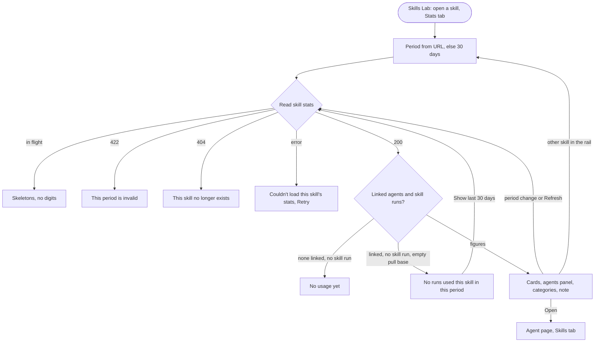
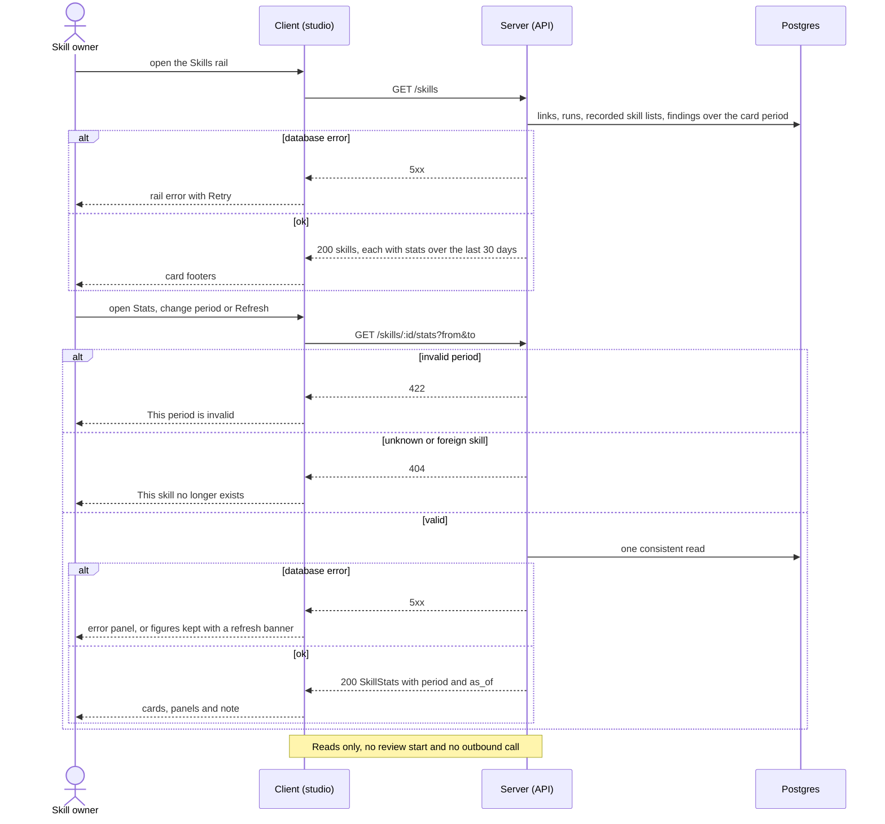
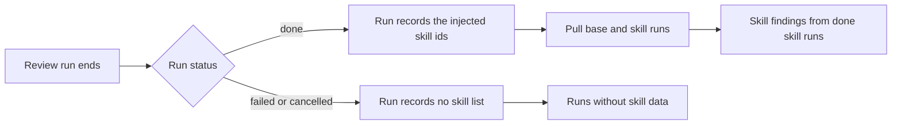

# Spec: Skill Stats tab — period, agent-consistent accept and pull rules, design alignment and card footer
Spec ID: 2026-10-15-skill-stats-tab
Status: approved
Supersedes: none
Modules: server, client, e2e

## Problem and user

The user is a skill owner. They link skills (rubrics, conventions, security gates) to review agents and want to know whether each skill earns its place. They want to see who uses it, how often it actually reaches the prompt, how many findings come from runs that used it, and how many of those findings people accept.

The Skills Lab already has a Stats tab for each skill (L02). Its numbers follow a rule of their own:
- **A fixed window, by review date.** Findings and the accept rate come from reviews of the agents linked *now*, created in the last 30 days (`server/src/modules/skills/repository.ts:343-360`, `server/src/modules/skills/constants.ts:15-16`). Reviews that no run produced, such as the seeded review in `server/src/db/seed-eval.ts:76-93`, are included.
- **An all-time, unfiltered pull frequency.** It counts every run of the linked agents at any time and of any status or source (`repository.ts:362-366`). Runs that recorded no skill list (runs from before skill tracking, failed and cancelled runs) sit in the denominator. A skill whose agents only have such runs therefore shows 0%, although the contract says null (`server/src/modules/skills/helpers.ts:294-296` vs `server/src/vendor/shared/contracts/knowledge.ts:495-496`).
- **Unlinking rewrites history.** When a skill is unlinked from an agent, that agent's past runs and findings drop out of the skill's figures (`server/test/skill-stats.it.test.ts:190-200`).
- **No period, no denominators, no small-sample marker.** The tab shows four bare tiles (`client/src/app/skills/_components/SkillsView/_components/SkillEditor/_components/StatsTab/StatsTab.tsx:37-40`).
- **Error copy that says nothing.** A failed read shows "—" as the error text (`StatsTab.tsx:29`, `client/messages/en/skills.json:108`).
- **A card footer with its own flaws.** The rail card footer repeats the same figures in hard-coded English, as "1 agents" for one agent (`client/src/app/skills/_components/SkillCard/helpers.ts:10-14`).

The approved agent spec `2026-10-15-agent-performance-dashboard` defines a period, counted runs, decided findings, a small-sample threshold, an accept scale, and loading, empty and error rules for the agent screens. The skill tab follows none of them.

What this costs the skill owner:
- For the same period, a skill's accept rate cannot be compared with the agents that use it.
- A percentage cannot be judged without knowing how many runs or decisions it rests on.
- A skill unlinked from an agent loses the evidence of how it performed there.

## Goals / Non-goals

Goals
- Bring the existing skill Stats tab to the design:
  - four KPI cards: Used by, Pull frequency, Accept rate with a ring, Findings;
  - the "Agents using this skill" panel with an "Open" link per agent;
  - Findings by category as a ring whose legend shows counts, not dollars.
- Compute the tab with the approved agent spec's rules:
  - the same period control (1 day, 30 days or a custom range), kept in the URL, with exact bounds fixed on load;
  - counted runs and decided findings at their current decision;
  - the accept denominator, the small-sample marker (fewer than 10 decided findings) and the accept colour scale;
  - the same loading, empty and error rules, with no made-up zeros;
  - read-only: 0 model calls and no outbound call.
- Attribute findings to a skill by the only evidence that exists: the run's recorded skill list. Findings of every run whose prompt included the skill count, whichever agent ran it.
- Show the pull frequency with its denominator, and say how many runs have no skill data.
- Make the skill figures agree with the agent screens for the same fixed period, proven by integration-tested invariants.
- Put the rail card footer on the same rules over a rolling 30 days.

Non-goals
- **Editing or superseding the approved spec `2026-10-15-agent-performance-dashboard`.** It is neither edited nor superseded (see *Inputs and provenance*).
- **Attributing a finding to the skill that caused it.** No data source records causation. The tab says so in its note (AC-27).
- **Changing what a run records.** The run's recorded skill list is written as today, and nothing new is stored.
- **Comparisons with the previous period.** There are no change arrows on the skill tab (not in the design; Q10).
- **A runs sparkline, Findings by severity or a Run history on the skill tab** (not in the design; Q10).
- **Per-agent figures in the "Agents using this skill" panel.** The design shows name and "Open" only (Q10).
- **Any cost figure or cost label on the skill tab or card** (not in the design; Q10).
- **A skill Evals tab, the "Run on evals" button, or other changes to the skill editor's header and tab list** (not in this design scope; Q10; also a Non-goal of `2026-10-08-eval-pipeline`).
- **An "in progress" count on the skill tab.** Running runs are simply not counted (EC-8).
- **CI runs and eval runs in any figure** (agent Terms › Counted run).
- **Live updates or polling.** The figures change only on reload, Refresh or a period change.
- **A repository filter, and exporting the data.**
- **Removing `findings_30d`.** It stays as a deprecated alias, and its removal is not scheduled (Q3).
- **A new e2e flow.** The existing flow keeps passing, and the rules are proven by integration tests (Q12).

## User stories

- US-1 [must]: As a skill owner, I want the Stats tab to show who uses the skill, how often it reaches the prompt and how many findings came from runs that used it, for a period I choose, so that I can judge whether the skill earns its place.
- US-2 [must]: As a skill owner, I want the skill's figures computed by the same rules as the agent screens, so that a skill and its agents give consistent numbers for the same period.
- US-3 [must]: As a skill owner, I want every rate shown with its denominator, and small accept samples marked, so that I don't trust a percentage built on a handful of runs or decisions.
- US-4 [must]: As a skill owner, I want loading, empty and error states that never show made-up zeros, and a tab that never calls a model or any outbound service, so that the numbers are honest and looking costs nothing.
- US-5 [must]: As a skill owner, I want each skill card in the rail to show its 30-day agents, pull and accept by the same rules, so that I can compare skills without opening each one.

## Acceptance criteria (EARS)

### Terms

The criteria below use these terms:

- **Agent spec:** the approved spec `docs/specs/2026-10-15-agent-performance-dashboard.md`. "agent AC-n", "agent EC-n", "agent NFR-n" and "agent Terms" refer to it. Its Terms *Period*, *Counted run*, *Decided finding*, *Pending finding*, *Small sample* and *Accept scale* apply here unchanged.
- **Linked agent:** an agent of the caller's workspace that has the skill linked when the stats are read, enabled or disabled.
- **Recorded skill list:** the list of skill ids a run records as injected into its prompt.
  - A run without such a list has no skill data.
  - So does a run whose list is not a list of ids.
- **Skill run:** a counted run, by any agent (linked, unlinked or deleted), whose recorded skill list contains the skill.
- **Skill finding:** a finding produced by a skill run with status `done`, of every kind and every decision.
- **Pull base:** the counted runs of linked agents that have a recorded skill list.
- **Card period:** the 30 × 24 hours ending at the read time of a `GET /skills` request.
- **Whole percent:** a share × 100 rounded to the nearest integer, with halves rounded up, as today (`helpers.ts:296,300`).

### Skill figures (server)

- AC-1 [ubiquitous, US-1, must, verify: integration] The server shall return as the Used by list every linked agent with its id and name, ordered by name A→Z with no cap, `agent_count` being the length of that list (Q2; EC-24, EC-25).
- AC-2 [ubiquitous, US-3, must, verify: integration] The server shall report the pull figures as follows (Q2, Q4; EC-1, EC-4, EC-5, EC-6, EC-8, EC-20):
  - `pull_runs_total`: the number of runs in the pull base;
  - `pull_runs`: the number of those runs whose recorded skill list contains the skill;
  - `pull_pct`: `pull_runs` ÷ `pull_runs_total` as a whole percent, null when the pull base is empty.
- AC-3 [ubiquitous, US-3, must, verify: integration] The server shall report `runs_without_skill_data` as the number of counted runs of linked agents that have no recorded skill list (Q4; EC-7, EC-27).
- AC-4 [ubiquitous, US-1, must, verify: integration] The server shall count the skill findings, in total as `findings` and per category as `by_category` (Q2; EC-2, EC-3, EC-8, EC-10, EC-12, EC-13, EC-28).
- AC-5 [ubiquitous, US-2, must, verify: integration] The server shall compute `accepted`, `dismissed`, `pending`, `accept_rate` and `small_sample` by agent AC-11, AC-12, AC-13 and AC-14, with the skill findings in place of an agent's findings, and `accept_pct` being `accept_rate` as a whole percent, or null (EC-10, EC-11, EC-26).
- AC-6 [ubiquitous, US-4, must, verify: integration] The server shall report `skill_runs` as the number of skill runs in the period [proposed → Q-1].
- AC-7 [ubiquitous, US-4, must, verify: integration] The server shall report `last_used_at` as the start time of the latest run whose recorded skill list contains the skill. It counts runs of any agent, at any time, with status `done`, `failed` or `cancelled`, and is null when there is none (Q6).

### Request, response and read-only guarantee (server)

- AC-8 [ubiquitous, US-1, must, verify: integration] The server shall return with every skill stats object the period its figures cover, as `period`, and the read time `as_of` (Q3; EC-14). On `GET /skills/:id/stats` that period is:
  - the given `from` and `to`;
  - or, when both are omitted, the 30 × 24 hours ending at `as_of`.
- AC-9 [unwanted, US-1, must, verify: integration] ЯКЩО a `GET /skills/:id/stats` request gives only one of `from` and `to`, or a value that fails agent AC-35 or AC-36, ТОДІ the server shall respond 422 with no figures (Q3).
- AC-10 [unwanted, US-4, must, verify: integration] ЯКЩО the skill of a `GET /skills/:id/stats` request is unknown or belongs to another workspace, ТОДІ the server shall respond 404 (EC-15).
- AC-11 [ubiquitous, US-5, must, verify: integration] The server shall compute each skill's `stats` in the `GET /skills` list by AC-1 to AC-7 over the card period (Q3, Q5; EC-18).
- AC-12 [ubiquitous, US-4, must, verify: integration] The server shall start no review run and make no outbound call (no LLM provider, GitHub or other external request) while serving `GET /skills/:id/stats` or `GET /skills` (agent AC-40; EC-19).

### Consistency with the agent screens (server)

- AC-13 [event, US-2, must, verify: integration] КОЛИ a skill with exactly one linked agent and that agent's Stats are read for the same fixed period with no stored change in between, the server shall return the skill's `pull_runs` and `pull_runs_total` equal to that agent's run count for the skill and its `runs_with_skill_data` (agent AC-32).
- AC-14 [event, US-2, must, verify: integration] КОЛИ the skill and one agent are read for the same fixed period with no stored change in between, and in that period every counted `done` run of that agent loaded the skill while no other agent's run did, the server shall return the skill's figures equal to that agent's, pair by pair (agent AC-11, AC-12, AC-13, AC-31):

  | Skill figure | Equals the agent's |
  |---|---|
  | `findings` | sum of its `findings_by_category` |
  | `by_category` | `findings_by_category` |
  | `accepted`, `dismissed`, `pending` | accepted, dismissed and pending counts |
  | `accept_rate` | Accept rate |

### Stats tab — period and reads (client)

- AC-15 [ubiquitous, US-1, must, verify: unit] The skill Stats tab shall meet agent AC-44 to AC-55, with the skill Stats tab in place of the agent screens (D-GAP-1; C-3). That means:
  - the period control, with "30 days" selected by default;
  - the option and the exact `from` and `to` written into the URL beside `tab=stats`;
  - a preset fixed to exact bounds on load;
  - the resolved start and end shown;
  - the option named in the Pull frequency, Accept rate, Findings and Findings by category labels, for example "Findings (30 days)";
  - agent AC-53 at its own priority (should).
- AC-16 [event, US-1, should, verify: unit] КОЛИ the user selects another skill in the rail or another editor tab, the skills page shall keep the period option, `from` and `to` in the URL (UX-3; EC-16, EC-17).
- AC-17 [ubiquitous, US-4, must, verify: unit] The skill Stats tab shall meet agent AC-41, AC-42 and AC-43: GET requests only, no second read of a period already in flight, and no timed re-read (EC-19).

### Stats tab — cards, panels and notes (client)

- AC-18 [ubiquitous, US-1, must, verify: unit] The Used by card shall show `agent_count` with a singular or plural unit, for example "1 agent" or "3 agents".
- AC-19 [ubiquitous, US-3, must, verify: unit] The Pull frequency card shall show `pull_pct` as a percent with "m of n runs" under it (`pull_runs` of `pull_runs_total`). When `pull_pct` is null, it shall show "—" with "No skill data for this period" (Q4; UX-1; D-GAP-3; EC-20).
- AC-20 [optional, US-3, must, verify: unit] ДЕ `runs_without_skill_data` is above 0, the Pull frequency card shall show "n runs without skill data are not included — runs recorded before skill tracking, and failed or cancelled runs" (Q4; EC-7).
- AC-21 [ubiquitous, US-3, should, verify: unit] The Pull frequency label shall show the hint "Share of linked agents' runs whose prompt included this skill" on hover and on keyboard focus (Q9; UX-7).
- AC-22 [ubiquitous, US-3, must, verify: unit] The Accept rate card shall show the rate as agent AC-147 specifies, coloured per agent AC-115. When `accept_rate` is null, it shall show "—" with "0 decided" and a ring with no accept colour (UX-1; D-GAP-2; EC-26).
- AC-23 [ubiquitous, US-1, must, verify: unit] The Findings card shall show `findings` (EC-21).
- AC-24 [ubiquitous, US-1, must, verify: unit] The "Agents using this skill" panel shall show one row per agent of the Used by list, in that list's order. Each row has an agent icon, the name (shortened per agent AC-127) and an "Open" link to `/agents/<id>?tab=skills` (Q8; D-GAP-9; EC-22, EC-24).
- AC-25 [optional, US-1, must, verify: unit] ДЕ the Used by list is empty while the tab shows figures, the "Agents using this skill" panel shall show "Not linked to any agent — the figures come from runs of agents that are no longer linked" [proposed → Q-1] (EC-2, EC-28).
- AC-26 [ubiquitous, US-1, must, verify: unit] The Findings by category panel shall meet agent AC-154 and AC-155 (D-GAP-4; C-4; EC-22, EC-23):
  - a ring and a legend giving each category, its count and its share, with no currency sign;
  - the 5 largest categories plus "Other";
  - names shortened per agent AC-127;
  - "No findings in this period" when `findings` is 0.
- AC-27 [ubiquitous, US-2, must, verify: unit] The tab shall show the note "Counted from local review runs whose prompt included this skill, including runs by agents no longer linked. A finding can't be traced to the skill that caused it." (Q9; D-GAP-15; EC-2, EC-9).
- AC-28 [optional, US-1, should, verify: unit] ДЕ the skill is disabled, the tab shall show "This skill is disabled — linked agents' runs don't load it" (UX-8; EC-4).

### Stats tab — loading, error and empty states (client)

- AC-29 [state, US-4, must, verify: unit] ПОКИ the tab's first read is in flight, the tab shall show skeleton placeholders in the four cards and both panels, with no digit or currency sign (agent AC-172; D-GAP-5).
- AC-30 [unwanted, US-4, must, verify: unit] ЯКЩО a read of the tab fails or responds 422, ТОДІ the tab shall behave as agent AC-173, AC-174 and AC-176 specify, with the title "Couldn't load this skill's stats" (D-GAP-6, D-GAP-13).
- AC-31 [unwanted, US-4, must, verify: unit] ЯКЩО the read responds 404, ТОДІ the tab shall show "This skill no longer exists", with a link to `/skills`, in place of the figures (EC-15).
- AC-32 [state, US-4, must, verify: unit] ПОКИ the Stats tab is open, the skills page shall meet agent AC-56, AC-57 and AC-175 (Q7; D-GAP-11; EC-18):
  - the topbar Refresh;
  - "Updated HH:MM";
  - figures kept, with the "Couldn't refresh" banner, when a refresh fails.
- AC-33 [state, US-4, must, verify: unit] ПОКИ the Used by list is empty and `skill_runs` is 0, the tab shall show "No usage yet — this skill isn't linked to any agent. Link it to an agent to start collecting stats." in place of the cards, panels and note (Q6; D-GAP-8).
- AC-34 [state, US-4, must, verify: unit] ПОКИ the Used by list is not empty, `skill_runs` is 0 and `pull_runs_total` is 0, the tab shall show an empty state in place of the cards and the Findings by category panel (Q6; D-GAP-7) [condition and "not used yet" proposed → Q-1]:
  - the text "No runs used this skill in this period · last used <date>", or "not used yet" in place of the date when `last_used_at` is null;
  - a "Show last 30 days" action, unless "30 days" is selected.

### Rail card footer (client)

- AC-35 [ubiquitous, US-5, must, verify: unit] Each skill card in the rail shall show the footer "n agent(s) · x% pull · y% accept" from that skill's `stats` in the `GET /skills` response. The unit is singular or plural, and the accept percent is coloured by the accept scale (agent AC-115) (Q5; C-2; D-GAP-12).
- AC-36 [optional, US-5, must, verify: unit] ДЕ the card's `small_sample` is true and its `accept_rate` is not null, the card footer shall show "small sample" in grey in place of the accept percent (Q5).
- AC-37 [unwanted, US-5, must, verify: unit] ЯКЩО `pull_pct` or `accept_pct` is null, ТОДІ the card footer shall show "—" in place of that percent ("— pull", "— accept") (Q5).
- AC-38 [optional, US-5, must, verify: unit] ДЕ the skill has no linked agent, the card shall show no stats footer (Q5; C-5).
- AC-39 [ubiquitous, US-5, should, verify: unit] The card footer shall show "m of n runs · x of y decided" on hover and on keyboard focus (UX-9).

### e2e

- AC-40 [ubiquitous, US-1, must, verify: e2e] The existing flow `08-skills` shall pass on the seeded e2e stack, with its text waits matching the rendered text of the Stats tab's labels (Q12).

## Edge cases

UI state matrix (`ux-design-review`):

| Screen / component | Default | Empty | Loading | Partial / streaming | Error | Degraded | No access / no token | First run | Long content | Stale |
|---|---|---|---|---|---|---|---|---|---|---|
| Stats › period control | AC-15 | n/a — always has a value | AC-29 | n/a — no streaming | AC-15 (agent AC-48, AC-49), AC-30 | n/a — client only | n/a — no key needed | AC-15 (30 days by default, agent AC-52) | n/a — fixed options | AC-16, AC-32 |
| Stats › KPI cards | AC-18, AC-19, AC-22, AC-23 | AC-33, AC-34 | AC-29 | AC-19, AC-20, AC-22, EC-7, EC-26 | AC-30, AC-31 | n/a — reads make no outbound call (AC-12) | AC-31 (unknown or foreign skill) | AC-33 | AC-23, EC-21 | AC-32 |
| Stats › Agents using this skill | AC-24 | AC-25, AC-33 | AC-29 | n/a — the list is complete | AC-30 | n/a — no outbound call | n/a — no key needed | AC-33 | AC-24, EC-22, EC-24 | AC-32 |
| Stats › Findings by category | AC-26 | AC-26, AC-34 | AC-29 | n/a — counts are complete for the period | AC-30 | n/a — no outbound call | n/a — no key needed | AC-33 | AC-26, EC-22, EC-23 | AC-32 |
| Stats › notes (attribution, disabled skill) | AC-27, AC-28 | n/a — static text | n/a — shown with the figures | n/a — static text | n/a — static text | n/a — static text | n/a — static text | n/a — replaced by AC-33 | n/a — fixed text | n/a — static text |
| Rail › skill card footer | AC-35, AC-39 | AC-38 | n/a — arrives with the list response | AC-36, AC-37 | n/a — a list error replaces the whole rail (`SkillsView.tsx:91`) | n/a — no outbound call | n/a — no key needed | AC-38 | n/a — three short segments | EC-18 |

- EC-1: The skill is linked to an agent mid-period → that agent's earlier runs have a recorded skill list without the skill:
  - they count in `pull_runs_total` only;
  - findings come only from runs that loaded the skill (→ AC-2, AC-4).
- EC-2: The skill is unlinked from an agent mid-period →
  - that agent's skill runs still count in findings, accept and categories;
  - the agent is not in Used by;
  - the note says such runs are included;
  - with no agent linked, the panel says the figures come from agents no longer linked (→ AC-4, AC-25, AC-27).
- EC-3: Runs of a deleted agent (the run keeps a null agent link, `server/src/db/schema/runs.ts:15`) → its skill runs count in the findings figures, and it is never listed (→ AC-1, AC-4).
- EC-4: The skill is disabled during the period (only enabled skills are injected, `server/src/modules/skills/repository.ts:220`) →
  - linked agents' runs stop loading it, so pull falls;
  - the tab shows the disabled hint (→ AC-2, AC-28).
- EC-5: The skill fails the safety check (`repository.ts:222`) →
  - it is never injected, and pull counts those runs as not loading it;
  - the card keeps its "blocked" badge (`SkillCard.tsx:100`) (→ AC-2).
- EC-6: The skills lookup failed during a run → the run records an empty skill list (`server/src/modules/reviews/run-executor.ts:541-545`, `:437`). It is in the pull base, as not loading the skill (→ AC-2).
- EC-7: Runs recorded before skill tracking, and every failed or cancelled run, have no recorded skill list (`run-executor.ts:740-748`) →
  - they are left out of the pull base;
  - they are counted in `runs_without_skill_data`, which the card's note reports (→ AC-3, AC-20).
- EC-8: Runs with status `running` when the stats are read → in no figure (agent AC-2) (→ AC-2, AC-4).
- EC-9: CI runs and eval runs → not counted (agent Terms › Counted run). The note says "local review runs" (→ AC-27).
- EC-10: Reviews with no linked run, such as the seeded review in `server/src/db/seed-eval.ts:76-93` → their findings are not skill findings (agent EC-22). They counted before this spec (→ AC-4, AC-5).
- EC-11: A finding re-triaged from accepted to dismissed, or back → counted by its decision at read time (agent EC-23) (→ AC-5).
- EC-12: Runs from a multi-agent group → each member run counts once, for its own agent (agent EC-29) (→ AC-4).
- EC-13: Two agents that both loaded the skill flag the same issue on one PR → two findings from two runs, no de-duplication (→ AC-4).
- EC-14: A run that started exactly at `from` or `to` → `from` is included and `to` excluded, by run start time (agent EC-24) (→ AC-8).
- EC-15: The skill was deleted, or the id belongs to another workspace → 404, and the tab shows "This skill no longer exists" (→ AC-10, AC-31).
- EC-16: The user switches skills in the rail while a period is selected → the period stays. Today the rail link sets only `tab` (`client/src/app/skills/_components/SkillsView/SkillsView.tsx:106`) (→ AC-16).
- EC-17: The user switches editor tabs and returns to Stats → the period stays (`SkillsView.tsx:38-43`) (→ AC-16).
- EC-18: The card's 30 days are fixed when the list is read, and the tab's "30 days" when the tab loads → the two can differ by runs that finished in between. Refresh brings them in line (→ AC-11, AC-32).
- EC-19: Repeated period changes or Refresh clicks → at most one read per period is in flight, with no model call and no outbound call (→ AC-12, AC-17).
- EC-20: Linked agents ran in the period, but none of those runs has a recorded skill list → pull shows "—" with "No skill data for this period", never 0% (→ AC-2, AC-19).
- EC-21: Large values (≥ 1,000 findings or runs) → shown with locale thousands separators (→ AC-23, NFR-12).
- EC-22: Long agent or category names (categories are LLM text) → shortened with an ellipsis. The full value shows on hover, on focus and in the accessible name (agent AC-127) (→ AC-24, AC-26).
- EC-23: More than 5 categories → the 5 largest plus "Other". The legend adds up to the Findings card (→ AC-26).
- EC-24: Many linked agents, for example 30 → all listed, A→Z, with no cap (→ AC-1, AC-24).
- EC-25: A disabled agent linked to the skill → counted in Used by and listed, as today (`repository.ts:337-340`) (→ AC-1).
- EC-26: Skill findings exist, but none is decided → Accept shows "—" with "0 decided" (→ AC-5, AC-22).
- EC-27: A run's recorded skill list is not a list of ids → that run has no skill data, and the read still answers 200 (→ AC-3, NFR-6).
- EC-28: Demo data records the skill in runs of an agent that is not linked to it → it behaves as EC-2 (→ AC-4, AC-25).

## Non-functional requirements

- NFR-1 [Performance, verify: integration] `GET /skills/:id/stats` shall respond with p95 ≤ 500 ms, for a 30-day and for a 366-day period, on the dataset of agent NFR-1 (10,000 runs, 50,000 findings, 20 agents), where the runs carry recorded skill lists (Q11).
- NFR-2 [Performance, verify: integration] `GET /skills` shall respond with p95 ≤ 500 ms for a workspace with 50 skills on the same dataset (Q11).
- NFR-3 [Performance, verify: manual — browser timing on the seeded stack] The tab's skeletons shall appear within 100 ms of opening the Stats tab (agent NFR-3; Q11).
- NFR-4 [LLM cost, verify: integration] Every action on the Stats tab and the rail shall make 0 LLM model calls, start 0 reviews and make 0 GitHub or other outbound requests:
  - opening, reloading or refreshing;
  - changing the period;
  - switching skills or tabs;
  - following "Open".

  No feature-model setting applies, because no model is called (agent NFR-5).
- NFR-5 [Limits, verify: unit] Limits:
  - a custom range covers at most 366 calendar days, and the server allows a span of 367 days (agent NFR-6);
  - the category legend shows the 5 largest plus "Other";
  - the agents panel has no cap;
  - the rail takes every card's stats from the one `GET /skills` response, with no stats request per card (`client/specs/pages.md:118-120`).
- NFR-6 [Reliability, verify: integration] Each skill stats object shall be computed from one consistent read of the stored data (agent NFR-8). As a result:
  - `pull_runs` ≤ `pull_runs_total`;
  - the `by_category` counts and `accepted` + `dismissed` + `pending` each sum to `findings`;
  - a run with a malformed recorded skill list never causes a 5xx (EC-27);
  - a repeated read of unchanged data returns identical figures.
- NFR-7 [Security, verify: integration] Every untrusted input shall be handled as listed in *Untrusted inputs*.
- NFR-8 [Accessibility, verify: unit] Agent NFR-11 to NFR-14 shall hold on the skill Stats tab:
  - keyboard operation of the period control, in visual order, with visible focus;
  - no meaning by colour alone: the small sample has text, and the accept colour sits next to its percent;
  - text equivalents for the ring and the donut;
  - a polite live region for "Updated" and for the refresh error.

  Each "Open" link has the accessible name "Open <agent name>" (Q8; UX-2; WCAG 2.4.4).
- NFR-9 [Accessibility, verify: manual — visual check of the tab and the rail] The tab and the card footer shall meet the visual checks of agent NFR-15:
  - reflow at 320 px and at 200 % zoom;
  - 4.5:1 contrast for muted text and for the coloured accept text on a card;
  - 3:1 for chart marks and focus rings;
  - targets, the "Open" links included, at least 24 × 24 CSS px (UX-2; WCAG 2.5.8).
- NFR-10 [Observability, verify: integration] The server shall log one line per `GET /skills/:id/stats` request with route, workspace id, period and duration in ms. The line holds no finding text and no skill body (Q11).
- NFR-11 [Compatibility, verify: integration]
  - A `GET /skills/:id/stats` request without `from` and `to` answers 200 with every key the old contract had.
  - `findings_30d` always equals `findings`.
  - Every vendored copy of the shared contract carries the same `SkillStats` shape (see *Contracts*).
  - `RunTrace`, the agent spec's endpoints and the skill and agent-link endpoints keep their shapes.
  - This spec stores no new data.
- NFR-12 [i18n, verify: unit] Every user-visible string of the Stats tab and the card footer shall come from `client/messages/en`, including the footer strings hard-coded today (`SkillCard/helpers.ts:11-13`). This includes:
  - singular and plural forms ("1 agent", "3 agents");
  - numbers and dates in locale format, with thousands separators (EC-21).

## Workflow and module communication

User workflow on the skill Stats tab:

Reads (client ↔ server), with failure branches:

Where the skill data comes from (the review flow, unchanged by this spec):

The agent Stats read (agent spec) and the skill stats read work from the same stored runs, recorded skill lists and finding decisions. AC-13 and AC-14 pin the figures that must agree.

## Contracts

Wire fields are `snake_case`. This is an **intentional, recorded semantic break** (Q3).
- **What makes it breaking:** the existing keys keep their names and types but take a new meaning. `breaking-change` lists "Endpoint semantics changed" as a break.
- **Why it is accepted:**
  - it leaves one rule set instead of two;
  - an old request still answers 200 with every key it read;
  - every known consumer is in this repository (an external consumer is not known, though absence isn't proof).

**`SkillStats`** (changed — breaking, semantic). It is the body of `GET /skills/:id/stats` and the `stats` of each `SkillWithStats` row of `GET /skills`.

| Field | Type | Status |
|---|---|---|
| `agent_count` | int | unchanged meaning: the number of linked agents |
| `agents` | `{ id: string, name: string }[]` | unchanged shape; now ordered by name A→Z |
| `pull_pct` | number, nullable — whole percent | changed meaning (AC-2) |
| `accept_pct` | number, nullable — whole percent | changed meaning (AC-5) |
| `findings_30d` | int | changed: `@deprecated` alias of `findings`; removal not scheduled |
| `by_category` | `{ category: string, count: int }[]` | changed meaning (AC-4) |
| `findings` | int | new |
| `skill_runs` | int | new [proposed → Q-1] |
| `pull_runs`, `pull_runs_total` | int | new |
| `runs_without_skill_data` | int | new |
| `accepted`, `dismissed`, `pending` | int | new |
| `accept_rate` | number 0..1, nullable | new |
| `small_sample` | boolean | new |
| `last_used_at` | string (ISO-8601), nullable | new |
| `period` | `{ from: string, to: string }` (ISO-8601) | new |
| `as_of` | string (ISO-8601) | new |

Endpoints:

**`GET /skills/:id/stats?from=<ISO>&to=<ISO>`** → `SkillStats` (changed).
- **Query:** `from` and `to` are new and optional as a pair. When both are omitted, the period is the last 30 × 24 hours.
- **Status:**
  - 200;
  - 404 for an unknown or foreign skill, as today;
  - 422 for an invalid or half-given period. This is new and reachable only by requests that send the new parameters.
- **Breaking:** yes, semantic. The keys and types an old reader uses are all still present.

**`GET /skills`** → `SkillWithStats[]` (changed). Each row's `stats` is computed over the card period (AC-11).
- **Breaking:** yes, semantic. The change to the shape is additive only.

**Consumers of the changed contract:**
- **client:**
  - the skill Stats tab (through the skill stats data hook);
  - the skill card footer;
  - the Skills view (row type only);
  - the client unit tests for the tab and the card.
- **e2e:** the flow `08-skills` asserts the Stats tab's rendered labels.
- **mcp-server:** keeps a vendored copy of the contract file (kept in sync, no runtime caller).
- **server tests:** they assert the old semantics.
- **Docs:** `docs/specs/conventions.md:238` names `SkillStats.accept_pct`.

**Deprecation of `findings_30d`** (`deprecation-policy`):

| Criterion | Answer |
|---|---|
| Marker | `@deprecated` on the contract field |
| Replacement | `findings` |
| Migration | read `findings` |
| Timeline | removal not scheduled |
| Compatibility window | open-ended; `findings_30d` keeps the value of `findings` |

**Unchanged:**
- `RunTrace` (the recorded skill list);
- `POST /agents/:id/skills` and the other skill and agent-link endpoints;
- every endpoint and contract of the agent spec (`AgentStats`, `AgentPerf`, `AgentRunHistoryPage`).

## Rollout and compatibility

- **Existing data.** Every figure comes from data already stored: runs, their recorded skill lists, findings and their decisions, skill links and agents.
  - Runs recorded before skill tracking count in `runs_without_skill_data`.
  - Run-less seeded reviews no longer count (EC-10).
- **Migration.** This spec stores no new data, so it needs no data migration. If the plan adds an index to meet NFR-1 or NFR-2, that index is a migration, applied manually (`pnpm db:migrate`); the server does not migrate on boot.
- **Existing API and MCP consumers.** See *Contracts*.
  - The semantic break is intentional and recorded (Q3).
  - An old request without a period still gets 200 with every old key.
  - The mcp-server copy of the contract must stay in sync. It has no runtime caller.
- **No feature flag.** The new rules apply after upgrade.
- **First use after upgrade:**
  - every skill card and Stats tab shows figures by the new rules (30 days by run start, runs that loaded the skill), so the numbers change from those seen before;
  - the tab opens on "30 days";
  - a skill whose agents only have runs without skill data shows "—" for pull, no longer 0%.
- **No key needed.** Every read uses stored data only, so the tab works without an LLM key or `GITHUB_TOKEN`.

## Inputs and provenance

- **User request.**
  - The Stats feature must also cover Skills Lab › Skills › <skill> › Stats.
  - Bring the existing tab to the design.
  - Compute it with the approved agent spec's rules: the period control (1 day, 30 days or custom, in the URL, exact bounds fixed on load), accept from the counted runs' findings at their current decision, the denominator, the small-sample marker below 10 decided, the accept scale (≥ 75, 50–74, < 50, grey for a small sample), the same loading, empty and error rules, and read-only (0 model calls).
  - The numbers must be consistent with the agent screens for the same period.
  - Delivery: a separate small spec.
- **Relation to the approved agent spec (C-1).** User decision 2026-10-15:
  - change the skill Stats tab in a separate spec;
  - 2026-10-15-agent-performance-dashboard is neither edited nor superseded;
  - its Non-goal (`:58`) and *Contracts › Unchanged* (`:623`) are read as describing that spec's own scope.

  No AC, EC or NFR of that spec constrains the skill tab or `SkillStats`, so this spec contradicts none of its requirements. The precedent is that spec's Q10 handling of multi-agent AC-43 (`docs/specs/2026-10-15-agent-performance-dashboard.md:633-636`).
- **Designs** (treated as data):
  - `/private/tmp/claude-501/-Users-sdiachenko-web-dev-cource-projects-dev-digest/53bbb112-4ec5-40ef-890f-4460620f74e1/images/7.png` (the user's screenshot) and `docs/designs/agent-performance/screenshots/skill-stats-tab.png` (same content). Taken from them:
    - the four KPI cards (USED BY "3 agents", PULL FREQUENCY "71%", ACCEPT RATE "74%" with a ring, FINDINGS (30D) "96");
    - the "Agents using this skill" rows with icon, name and "Open";
    - Findings by category as a ring;
    - the card footer "3 agents · 71% pull · 74% accept";
    - the topbar refresh icon.
  - `docs/designs/eval-pipeline/jsx/screen_skills.jsx`:
    - `:19-38` — the card footer, hidden when no agent uses the skill (C-5), and its 60% green threshold, overridden by the accept scale (C-2);
    - `:140-157` — the Stats tab layout;
    - `:141` — the "No usage yet" empty state (AC-33).
  - `docs/designs/agent-performance/jsx/charts.jsx:31-47` — the Donut prints "$" for any value, so categories show counts (C-4, AC-26).
  - `docs/designs/agent-performance/jsx/primitives.jsx:168-170` — the ring thresholds 75/50, which match the accept scale.
  - `docs/designs/eval-pipeline/jsx/data.jsx:251-264` — mock values only.
- **User answers** (binding):
  - Q1 (a) — one spec.
  - Q2 (a) — the mixed scope:
    - Used by and the panel are agents linked now;
    - pull is over linked agents' runs with skill data;
    - findings, accept and categories come from skill runs of any agent (AC-1–AC-5).
  - Q3 (a) — change in place as an intentional, recorded semantic break:
    - `from` and `to` optional;
    - `findings_30d` a deprecated alias;
    - the new fields;
    - list stats over a rolling 30 days fixed by the server (AC-8–AC-11, *Contracts*).
  - Q4 (a) — the pull denominator "m of n runs", a note on runs without skill data, null when n = 0, no small-sample marker for pull (AC-2, AC-3, AC-19, AC-20).
  - Q5 (a) — the card footer (AC-35–AC-38).
  - Q6 (a) — two empty states (AC-33, AC-34).
  - Q7 (a) — Refresh and "Updated" (AC-32).
  - Q8 (a) — "Open" goes to the agent's Skills tab, named "Open <agent>" (AC-24, NFR-8).
  - Q9 (a) — the reworded note and the pull hint (AC-21, AC-27).
  - Q10 — EC-1–EC-28, UX-1, UX-2, UX-3, UX-8 and UX-9 accepted, and the undrawn items made Non-goals.
  - Q11 — the NFR targets (NFR-1–NFR-3, NFR-10).
  - Q12 (a) — keep `08-skills` passing; integration tests for the rules and invariants; no new flow (AC-13, AC-14, AC-40).
- **UX proposals accepted:**
  - UX-1 → AC-19, AC-22
  - UX-2 → NFR-8, NFR-9
  - UX-3 → AC-16
  - UX-7 → AC-21
  - UX-8 → AC-28
  - UX-9 → AC-39
- **Research:** none was needed. Every fact is in the repository.
- **Existing code and specs cited:**
  - current skill stats:
    - `server/src/modules/skills/helpers.ts:261-269,293-313`;
    - `server/src/modules/skills/repository.ts:215-228,326-382`;
    - `server/src/modules/skills/constants.ts:15-16`;
    - `server/src/modules/skills/routes.ts:150-159`;
    - `server/src/modules/skills/service.ts:53-73`;
    - `server/src/vendor/shared/contracts/knowledge.ts:487-511`.
  - recorded skill list:
    - `server/src/vendor/shared/contracts/trace.ts:115-119`;
    - `server/src/modules/reviews/run-executor.ts:336,437,541-545,740-748`.
  - client:
    - `StatsTab.tsx:14-72`;
    - `SkillCard/helpers.ts:10-14`;
    - `SkillCard.tsx:100,110-117`;
    - `SkillsView.tsx:35-43,91,106`;
    - `client/src/lib/hooks/skills.ts:106-112`;
    - `client/src/vendor/ui/shell/Topbar.tsx:76`.
  - seeds and tests:
    - `server/src/db/seed.ts:700-703`;
    - `server/src/db/seed-eval.ts:76-93`;
    - `server/test/skill-stats.it.test.ts:121-231`;
    - `e2e/specs/08-skills.flow.json:18-21`.
  - page guarantee: `client/specs/pages.md:118-120`.
  - agent spec: Terms `:80-101`; AC-11–AC-14, AC-31, AC-32, AC-35, AC-36, AC-40–AC-57, AC-115, AC-127, AC-147, AC-154, AC-155, AC-172–AC-176; NFR-1, NFR-3, NFR-5, NFR-6, NFR-8, NFR-11–NFR-15.
- **INSIGHTS** that shape requirements:
  - `server/INSIGHTS.md:29` — the recorded skill list exists only since L02 (AC-3, AC-20).
  - `server/INSIGHTS.md:23` — a missing figure stays null, never 0 (AC-2, AC-5).
  - `client/INSIGHTS.md:53` — the editor's `?tab=` must keep working with the period in the URL (AC-15).
  - `client/INSIGHTS.md:41` — i18n namespaces in test providers (NFR-12).
  - `e2e/INSIGHTS.md:21,23` — e2e waits match the rendered, possibly uppercase, text after the data loads (AC-40).
- **Size.** 40 ACs over server, client and one e2e flow. Agent AC groups are referenced by ID instead of restated: the period control, read-only, accept card, category, loading, error and refresh rules. The count is above the ~24–30 target because each answered option (Q5–Q9, UX-8, UX-9) and each invariant (AC-13, AC-14) adds its own one-response criterion. The user chose one spec (Q1).
- **Still `[proposed]`, confirmed by no answer:** the items in Q-1.

## Untrusted inputs

| Input | Source | OWASP | Required handling |
|---|---|---|---|
| `from`, `to` query values | any HTTP caller | A05, A06, A10 | Schema-validated before use. A half-given or invalid period → 422 (AC-9). The span is capped at 367 days. Never concatenated into query text. |
| Skill id in the path | URL | A01 | Resolved only inside the caller's workspace. Unknown or foreign → 404 with no data (AC-10). |
| Page URL period values | shared or edited links | A05, A10 | Validated before use. Invalid → 30 days with a notice (agent AC-52, AC-53, via AC-15). Never starts an action by itself. |
| Skill names (imported skills included) and agent names | user input, imported archives | A05 (XSS) | Rendered as plain text only, never as HTML or markdown. Shortened for display (AC-24). |
| Finding categories | LLM output stored with findings | A05 | Plain text in the legend and in accessible names, never markup. Shortened for display (AC-26). |
| A run's recorded skill list | stored, untyped run data | A05, A10 | A malformed list means "no skill data" and never fails the read (EC-27, NFR-6). Ids are compared as exact strings and never interpolated into query text. |
| Workspace scope | every read | A01 | Every figure, link and run is limited to the caller's workspace (AC-1, AC-10). |

## Traceability

| Story | AC | EC | NFR | Verify |
|---|---|---|---|---|
| US-1 | AC-1, AC-4, AC-8, AC-9, AC-15, AC-16, AC-18, AC-23, AC-24, AC-25, AC-26, AC-28, AC-40 | EC-2, EC-3, EC-12, EC-13, EC-14, EC-16, EC-17, EC-21, EC-22, EC-23, EC-24, EC-25, EC-28 | NFR-1, NFR-3, NFR-5, NFR-8, NFR-9, NFR-12 | integration, unit, e2e, manual |
| US-2 | AC-5, AC-13, AC-14, AC-27 | EC-9, EC-10, EC-11 | NFR-6 | integration, unit |
| US-3 | AC-2, AC-3, AC-19, AC-20, AC-21, AC-22 | EC-1, EC-4, EC-5, EC-6, EC-7, EC-8, EC-20, EC-26, EC-27 | NFR-8 | integration, unit |
| US-4 | AC-6, AC-7, AC-10, AC-12, AC-17, AC-29, AC-30, AC-31, AC-32, AC-33, AC-34 | EC-15, EC-19 | NFR-4, NFR-6, NFR-7, NFR-10, NFR-11 | integration, unit |
| US-5 | AC-11, AC-35, AC-36, AC-37, AC-38, AC-39 | EC-18 | NFR-2, NFR-5, NFR-11 | integration, unit |

## Open questions

- Q-1: Smaller details added while writing, to make the answered behaviour testable:
  - the `skill_runs` field (AC-6), needed for the conditions of the two empty states (AC-33, AC-34);
  - AC-34's condition, "linked agents, no skill run **and** an empty pull base". When linked agents ran without loading the skill, the cards show "0 of n runs" instead of the empty state;
  - "not used yet" in place of the date when `last_used_at` is null (AC-34);
  - the agents-panel text when no agent is linked but the period has skill runs (AC-25);
  - `period` as `{ from, to }`, without previous-period bounds, since the skill tab has no comparison.
  - Recommended: accept all as written.
  - owner: user — blocking: no.
